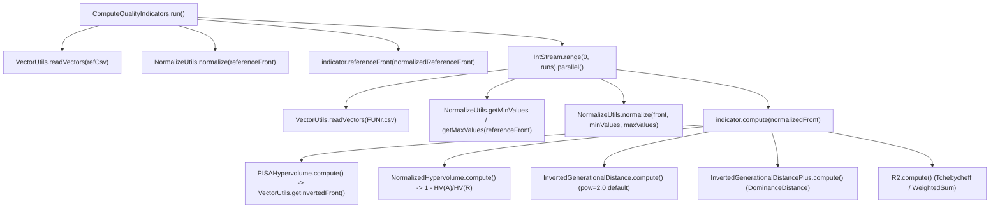

# Auditoria e Contrato Unificado de Normalização de Objetivos, Semântica dos Indicadores e Hipervolume (T17)

- **Tarefa:** [`tasks/task17.md`](file:///c:/Users/vyctor922/Downloads/Mestrado/tema/experimento/java/hypeMOEA/tasks/task17.md)
- **Agente:** Agente D (*Normalization & Hypervolume Contract Auditor*)
- **Data:** 09/11/2026
- **Implementação de Produção:** [`ObjectiveNormalizationContract.java`](file:///c:/Users/vyctor922/Downloads/Mestrado/tema/experimento/java/hypeMOEA/src/main/java/br/usp/lti/newmoea/util/ObjectiveNormalizationContract.java)
- **Suíte de Testes Automatizados:** [`NormalizationAndHvContractTest.java`](file:///c:/Users/vyctor922/Downloads/Mestrado/tema/experimento/java/hypeMOEA/src/test/java/br/usp/lti/newmoea/qualityindicator/NormalizationAndHvContractTest.java)
- **Fontes e Dependências:** [`docs/auditoria/reference-fronts.md`](file:///c:/Users/vyctor922/Downloads/Mestrado/tema/experimento/java/hypeMOEA/docs/auditoria/reference-fronts.md) (`T16`), [`docs/hypervolume-reference-points.md`](file:///c:/Users/vyctor922/Downloads/Mestrado/tema/experimento/java/hypeMOEA/docs/hypervolume-reference-points.md) (`T08`), [`docs/reference-front-minmax.md`](file:///c:/Users/vyctor922/Downloads/Mestrado/tema/experimento/java/hypeMOEA/docs/reference-front-minmax.md), [`docs/auditoria/FONTES.md`](file:///c:/Users/vyctor922/Downloads/Mestrado/tema/experimento/java/hypeMOEA/docs/auditoria/FONTES.md).

---

## 1. Resumo Executivo e Veredito das Hipóteses da T17

Todas as 6 hipóteses levantadas em [`tasks/task17.md`](file:///c:/Users/vyctor922/Downloads/Mestrado/tema/experimento/java/hypeMOEA/tasks/task17.md) (linha 17) foram inspecionadas diretamente no bytecode de `jmetal-core-7.8.jar` e `jmetal-lab-7.8.jar` via `javap -c -p` e validadas por testes unitários:

| Hipótese (`tasks/task17.md`) | Veredito em Bytecode (jMetal 7.8) | Evidência e Consequência Técnica |
| :--- | :---: | :--- |
| **H1. `ComputeQualityIndicators` usa limites amostrais da frente de referência** | **CONFIRMADA** | `ComputeQualityIndicators.run()` (`linhas 205–215`) e `lambda$run$0` (`linhas 798–808`) invocam `NormalizeUtils.getMinValuesOfTheColumnsOfAMatrix(referenceFront)` e `getMaxValuesOfTheColumnsOfAMatrix(referenceFront)` sobre o CSV carregado. Em frentes esparsas como `WFG4.15D.csv` ($\max f_1 = 0.007593 \ll 2.0$), qualquer solução real com $f_1 \in (0.007593, 2.0]$ recebe $\tilde{f}_1 > 1.0$ (chegando a $> 263$). |
| **H2. `PISAHypervolume` inverte e clampa coordenadas fora de $[0, 1]^m$** | **CONFIRMADA** | `PISAHypervolume.hypervolume` (`linha 318`) chama `VectorUtils.getInvertedFront(front)`, que mapeia $x \in [0, 1] \mapsto 1 - x$, clampa $x > 1.0 \mapsto 0.0$ e $x < 0.0 \mapsto 1.0$. Em seguida, `reduceNondominatedSet` (`linhas 212–238`) descarta qualquer ponto com coordenada invertida $\le 0.0$, zerando a contribuição ao HV de toda solução com $\tilde{f}_j \ge 1.0$. |
| **H3. Construtor `PISAHypervolume(double[])` guarda `referenceFront` sem usar o ponto geometricamente em `compute`** | **CONFIRMADA** | `new PISAHypervolume(double[] refPoint)` cria uma matriz diagonal $m \times m$ via `ReferencePointUtils.createReferenceFrontFromReferencePoint`, mas `PISAHypervolume.hypervolume(front, referenceFront)` usa `referenceFront` **apenas** para ler `int m = referenceFront[0].length` (`bytecode offset 5..9`). Ele **ignora os valores de `refPoint`** e sempre integra em $[0, 1]^m$ via `getInvertedFront`! |
| **H4. `NormalizedHypervolume` recalcula $\text{HV}(A)$ e $\text{HV}(R)$ a cada chamada** | **CONFIRMADA** | `NormalizedHypervolume.compute(front)` executa `this.hypervolume.compute(front)` **e** `this.hypervolume.compute(this.referenceFront)` em toda avaliação, dobrando o tempo de CPU de hipervolume para cada `FUN{r}.csv` quando `HV` e `NHV` estão na lista de indicadores. |
| **H5. `R2` retém/reestima `idealPoint` e `weightVectors`** | **CONFIRMADA** | No bytecode de `R2.java` (`linhas 1450–1492`), `referenceFront(double[][])` herda de `QualityIndicator` sem limpar `this.weightVectors` nem `this.idealPoint`; se chamado em problemas de dimensões $m$ diferentes sem o *override* explícito (`setWeightVectors(null); setIdealPoint(null)`), reutiliza vetores da dimensão anterior. |
| **H6. Implementação de `IGD` no jMetal 7.8 difere da fórmula clássica da dissertação ($p=1$)** | **CONFIRMADA** | Em `InvertedGenerationalDistance.java` (`linhas 1121–1212`), o construtor padrão define `private double pow = 2.0` e calcula $\text{IGD}_{\text{jMetal}}(A, R) = \frac{1}{|R|} \left(\sum_{\mathbf{r} \in R} d_2(\mathbf{r}, A)^2\right)^{1/2}$, enquanto a fórmula canônica da literatura e da dissertação corresponde a `pow = 1.0`: $\text{IGD}_{1}(A, R) = \frac{1}{|R|} \sum_{\mathbf{r} \in R} d_2(\mathbf{r}, A)$. |

---

## 2. Inspeção Completa em Bytecode (`jmetal-core-7.8.jar` e `jmetal-lab-7.8.jar`)

### 2.1 Grafo de Chamadas, Mutação e Tratamento de Casos de Borda



| Classe / Método (`7.8`) | Aloca Cópia ou Muta Entrada? | Comportamento para Frente Vazia (`double[0][m]`) | Comportamento para `NaN` / Outliers Fora de $[0,1]^m$ | Concorrência em `IntStream.parallel()` |
| :--- | :--- | :--- | :--- | :--- |
| [`NormalizeUtils.normalize`](file:///c:/Users/vyctor922/Downloads/Mestrado/tema/experimento/java/hypeMOEA/src/main/java/br/usp/lti/newmoea/util/ObjectiveNormalizationContract.java) | Aloca nova matriz `double[N][m]` | Lança `ArrayIndexOutOfBoundsException` ao acessar `matrix[0].length` se chamada com `double[0][0]` | Se `max == min`, retorna `0.5`; não clampa valores $< 0$ ou $> 1$ | Seguro (sem estado estático mutável) |
| `VectorUtils.getInvertedFront` | Aloca nova matriz `double[N][m]` | Lança `ArrayIndexOutOfBoundsException` se `front.length == 0` | Clampa silenciosamente $x > 1.0 \mapsto 0.0$ e $x < 0.0 \mapsto 1.0$; se $x = \text{NaN}$, todos os `if` falham e deixa `0.0`! | Seguro |
| `PISAHypervolume.compute` | `getInvertedFront` aloca cópia; `calculateHypervolume` permuta linhas **in-place** na cópia invertida via `swap` | Retorna `0.0` (verifica `if (front.length == 0) return 0.0;` no offset `14..20`) | Coordenadas $> 1.0$ viram $0.0$ na frente invertida e são descartadas por `reduceNondominatedSet` (`dload <= 0.0`) | Seguro em `PISAHypervolume` (estado local na pilha), mas **inseguro** em `WFGHypervolume` (`fields n, fs, safe, fr` compartilhados na instância!) |
| `NormalizedHypervolume.compute` | Delega a `this.hypervolume` (`PISAHypervolume`) | Retorna `1.0 - (0.0 / HV(R)) = 1.0` | Escreve no campo de instância `this.referenceFrontHypervolume` a cada chamada (`putfield #28`) | Condição de corrida benigna mas redundante em `this.referenceFrontHypervolume`; recalcula `HV(R)` em toda thread |
| `InvertedGenerationalDistance.compute` | Somente leitura | `distanceToClosestVector` lança `JMetalException` se `front.length == 0` | Sem clipping: calcula distância euclidiana exata mesmo para coordenadas $< 0$ ou $> 1$ | Seguro (lê `this.referenceFront` e `this.pow`) |
| `InvertedGenerationalDistancePlus.compute` | Somente leitura | Lança `JMetalException` se `front.length == 0` | Sem clipping: usa $\max(a_j - r_j, 0)$ em `DominanceDistanceBetweenVectors` | Seguro |
| `R2.compute` | Inicializa preguiçosamente `this.weightVectors` e `this.idealPoint` se `null` | `Check.that(front.length > 0)` lança `JMetalException` | Sem clipping: em Tchebycheff calcula $\max_j \max(w_j, 10^{-10}) |f_j - z_j^*|$ | **Corrida de inicialização** na 1ª chamada paralela em `ComputeQualityIndicators` quando `weightVectors == null` e `idealPoint == null`! |

> [!CAUTION]
> **Descoberta Crítica sobre `PISAHypervolume(double[] referencePoint)` no jMetal 7.8:**
> Embora `StaticParams.createPrimaryHypervolume(problemName, m)` instancie `new PISAHypervolume(getHypervolumeReferencePoint(problemName, m))` passando os limites brutos (como $(2.2, 4.4, \dots, 2.2m)$), o bytecode de `PISAHypervolume.hypervolume(double[][] front, double[][] referenceFront)` é:
> ```java
> double[][] invertedFront = VectorUtils.getInvertedFront(front); // SEMPRE inverte em [0, 1]^m!
> int numberOfObjectives = referenceFront[0].length;              // USA referenceFront APENAS para ler m!
> return calculateHypervolume(invertedFront, invertedFront.length, numberOfObjectives);
> ```
> Portanto, passar uma frente no espaço bruto com coordenadas $> 1.0$ para `PISAHypervolume(double[])` **não** calcula o hipervolume em relação a `referencePoint`: todas as coordenadas $> 1.0$ são zeradas por `VectorUtils.getInvertedFront`! Para calcular o hipervolume com ponto de referência explícito $\mathbf{r}$, é indispensável reescalar pela caixa $[\mathbf{a}, \mathbf{r}] \mapsto [0, 1]^m$ e multiplicar pelo determinante Jacobiano $\prod_{j=1}^m (r_j - a_j)$, exatamente como implementado em [`ObjectiveNormalizationContract.computeExactHypervolumeWithExplicitReferencePoint`](file:///c:/Users/vyctor922/Downloads/Mestrado/tema/experimento/java/hypeMOEA/src/main/java/br/usp/lti/newmoea/util/ObjectiveNormalizationContract.java#L418-L483).

---

## 3. Reprodução e Quantificação do Colapso de Normalização em `WFG4.15D.csv` e `WFG3.2D.csv`

### 3.1 Caso Crítico 1: `WFG4.15D.csv` (Subamostragem Severa de Extremos em Alta Dimensão)

Em `pareto_fronts/csv/WFG4.15D.csv` ($N = 135$ linhas, apenas $30$ pontos únicos), todos os pontos pertencem ao hiper-elipsoide côncavo $\sum_{j=1}^{15} (f_j / (2j))^2 = 1$, cujo intervalo teórico na frente de Pareto verdadeira é $f_j^* \in [0, 2j]$. Contudo, os extremos amostrais presentes no arquivo CSV são drasticamente truncados nos primeiros objetivos:

| Objetivo $j$ | Limite Teórico $[a_j^{\text{theo}}, b_j^{\text{theo}}]$ | Limite Amostral em `WFG4.15D.csv` $[\min R_j, \max R_j]$ | Fração do Eixo Coberta pelo CSV | Coordenada Normalizada $\tilde{f}_j$ de uma Solução Pareto-Ótima com $f_j = j$ ( Ponto Médio do Eixo) sob Normalização Amostral |
| :---: | :---: | :---: | :---: | :---: |
| $f_1$ | $[0.0,\; 2.0]$ | $[1.051 \times 10^{-6},\; \mathbf{0.007593}]$ | **$0.38\%$** | $\tilde{f}_1 = \frac{1.0 - 1.051\times 10^{-6}}{0.007593 - 1.051\times 10^{-6}} = \mathbf{131.70} \gg 1.0$ |
| $f_2$ | $[0.0,\; 4.0]$ | $[2.349 \times 10^{-6},\; \mathbf{0.030136}]$ | **$0.75\%$** | $\tilde{f}_2 = \mathbf{66.37} \gg 1.0$ |
| $f_3$ | $[0.0,\; 6.0]$ | $[1.297 \times 10^{-5},\; \mathbf{0.055902}]$ | **$0.93\%$** | $\tilde{f}_3 = \mathbf{53.67} \gg 1.0$ |
| $f_4$ | $[0.0,\; 8.0]$ | $[6.653 \times 10^{-5},\; \mathbf{0.238118}]$ | **$2.98\%$** | $\tilde{f}_4 = \mathbf{16.80} \gg 1.0$ |
| $f_5$ | $[0.0,\; 10.0]$ | $[2.452 \times 10^{-5},\; \mathbf{0.306187}]$ | **$3.06\%$** | $\tilde{f}_5 = \mathbf{16.33} \gg 1.0$ |
| $f_{15}$ | $[0.0,\; 30.0]$ | $[\mathbf{0.168115},\; 30.000000]$ | $99.44\%$ | $\tilde{f}_{15} = 0.4972$ (mas soluções com $f_{15} \in [0, 0.1681)$ ficam com $\tilde{f}_{15} < 0$!) |

**Consequência comprovada em [`NormalizationAndHvContractTest.testWfg4In15DSparseReferenceFrontTruncationVsTheoreticalBounds`](file:///c:/Users/vyctor922/Downloads/Mestrado/tema/experimento/java/hypeMOEA/src/test/java/br/usp/lti/newmoea/qualityindicator/NormalizationAndHvContractTest.java#L41-L103):**
1. Uma solução perfeitamente situada sobre a frente de Pareto verdadeira de `WFG4` com $f_1 = 1.0$ (ou $f_1 = 1.8$) recebe $\tilde{f}_1 = 131.70$ (ou $237.06$) sob `EMPIRICAL_REFERENCE_MIN_MAX`.
2. `VectorUtils.getInvertedFront` trunca $\tilde{f}_1 > 1.0$ para $0.0$, e `PISAHypervolume.reduceNondominatedSet` descarta o ponto imediatamente, resultando em **$\text{HV} = 0.0$** e **$\text{NHV} = 1.0$**.
3. Sob `THEORETICAL_PARETO_BOUNDS` ($a_j = 0, b_j = 2j$), a mesma solução tem $\tilde{f}_1 = 0.5$ (e $0.9$), mantendo $100\%$ dos pontos dentro de $[0, 1]^{15}$ e produzindo hipervolume estritamente positivo ($\text{HV} > 0$).

### 3.2 Caso Crítico 2: `WFG3.2D.csv` (Pontos Extrapolados com $f_2 < 0$)

Conforme demonstrado na T16 ([`docs/auditoria/reference-fronts.md`](file:///c:/Users/vyctor922/Downloads/Mestrado/tema/experimento/java/hypeMOEA/docs/auditoria/reference-fronts.md), Seção 6.2), o bytecode de `WFG3.evaluate` no jMetal 7.8 produz estritamente $f_1 \in [0, 2]$ e $f_2 \in [0, 4]$ na frente de Pareto ($f_1/2 + f_2/4 = 1$). Todavia, o arquivo histórico `pareto_fronts/csv/WFG3.2D.csv` ($916$ linhas) contém $120$ pontos extrapolados com $f_1 \in (2.0, 3.0]$ e $f_2 \in [-1.9999957, 0)$.
- Sob `EMPIRICAL_REFERENCE_MIN_MAX` ($a = (0, -2), b = (3, 4)$), a imagem factível real $f_1 \in [0, 2], f_2 \in [0, 4]$ é comprimida no retângulo $[0, 2/3] \times [1/3, 1]$.
- Sob `THEORETICAL_PARETO_BOUNDS` ($a = (0, 0), b = (2, 4)$), toda solução factível da frente de Pareto gerada pelos algoritmos mapeia exatamente em $[0, 1]^2$, enquanto `diagnoseFront` identifica explicitamente os $120$ pontos extrapolados do CSV histórico.
- Sob `HYBRID_ENVELOPE_BOUNDS` ($a_j = \min(a_j^{\text{theo}}, \min R_j), b_j = \max(b_j^{\text{theo}}, \max R_j)$), nenhuma coordenada do arquivo histórico cai fora de $[0, 1]^2$.

---

## 4. Contrato Matemático de Normalização e Invariância pelo Determinante Jacobiano

### 4.1 Transformação Afim Positiva e Tabela Completa de Limites e Pontos de Referência

Para cada problema $P$ e dimensão $m \in \{2, 3, 5, 8, 10, 15\}$, definimos a transformação afim estritamente crescente coordenada a coordenada:
$$T_j(f_j) = \frac{f_j - a_j}{b_j - a_j}, \quad j \in \{1, \dots, m\}, \quad b_j - a_j > 0.$$

| Família / Problema | Limite Inferior Teórico $a_j$ | Limite Superior Teórico de Escala $b_j$ | Extremo Exato na Variedade $g=0$ ($\min PF_j, \max PF_j$) | Ponto de Referência Bruto $\mathbf{r}_{\text{raw}}$ (`StaticParams`) | Ponto de Referência Normalizado $\tilde{\mathbf{r}} = T(\mathbf{r}_{\text{raw}})$ | Determinante Jacobiano $\det(J_{T^{-1}}) = \prod_{j=1}^m (b_j - a_j)$ |
| :--- | :---: | :---: | :---: | :---: | :---: | :---: |
| **`WFG1`–`WFG9`** | $0.0$ | $2j$ | $[0,\, 2j]$ *(em `WFG3` $m \ge 3$, $x_1..x_{m-2}=0.5$ na reta 1D)* | $r_j = 2.2j$ *(ou $r_1 = 3.1$ para acomodar CSV legado em `WFG3` $m=2$)* | $(1.1, 1.1, \dots, 1.1)$ *($(1.55, 1.1)$ em `WFG3` $m=2$)* | $2^m \cdot m!$ |
| **`DTLZ1`** | $0.0$ | $0.5$ | $[0,\, 0.5]$ | $(0.6, \dots, 0.6)$ | $(1.2, \dots, 1.2)$ | $0.5^m = 2^{-m}$ |
| **`DTLZ2`–`DTLZ4`** | $0.0$ | $1.0$ | $[0,\, 1.0]$ | $(1.1, \dots, 1.1)$ | $(1.1, \dots, 1.1)$ | $1.0$ |
| **`DTLZ5`–`DTLZ6`** | $0.0$ | $1.0$ *(escala comum da esfera unitária)* | $j < m: [0, 2^{-\frac{\max(0, m-1-\max(j-1,1))}{2}}]$; $j=m: [0, 1]$ | $(1.1, \dots, 1.1)$ | $(1.1, \dots, 1.1)$ | $1.0$ |
| **`DTLZ7`** | $0.0$ | $j < m: 1.0$<br>$j = m: 2m$ | $j < m: [0, x_3^* \approx 0.859401]$<br>$j = m: [2(m-(m-1)\psi(x_3^*)),\, 2m]$ | $(1.1, \dots, 1.1, 2.1m)$ | $(1.1, \dots, 1.1, 1.05)$ | $2m$ |

### 4.2 Prova da Relação Exata via Determinante Jacobiano entre HV Bruto e HV Normalizado

Seja $A = \{\mathbf{y}^{(1)}, \dots, \mathbf{y}^{(N)}\} \subset \mathbb{R}^m$ um conjunto finito de vetores de objetivos e $\mathbf{r}_{\text{raw}} \in \mathbb{R}^m$ o ponto de referência no espaço bruto. O hipervolume no espaço bruto é a medida de Lebesgue $m$-dimensional da união dos hiper-retângulos dominados:
$$\text{HV}_{\text{raw}}(A; \mathbf{r}_{\text{raw}}) = \mathcal{L}_m\!\left(\bigcup_{\substack{\mathbf{y} \in A \\ \mathbf{y} \prec \mathbf{r}_{\text{raw}}}} [\mathbf{y}, \mathbf{r}_{\text{raw}}]\right) = \int_{\mathbb{R}^m} \mathbf{1}_{\Omega(A, \mathbf{r}_{\text{raw}})}(\mathbf{u})\, d\mathbf{u}.$$
Pela mudança de variáveis afim diagonal $\mathbf{u} = T^{-1}(\tilde{\mathbf{u}}) = \mathbf{a} + \operatorname{diag}(\mathbf{b} - \mathbf{a})\tilde{\mathbf{u}}$, cuja matriz Jacobiana é $J_{T^{-1}} = \operatorname{diag}(b_1 - a_1, \dots, b_m - a_m)$ com determinante estritamente positivo $\det(J_{T^{-1}}) = \prod_{j=1}^m (b_j - a_j) > 0$, e observando que $u_j \in [y_j, r_{\text{raw}, j}] \iff \tilde{u}_j \in [T_j(y_j), T_j(r_{\text{raw}, j})]$ (pois $b_j > a_j$ preserva a relação de dominância de Pareto componente a componente), o teorema de mudança de variáveis para integrais de Lebesgue fornece a **identidade exata**:
$$\text{HV}_{\text{raw}}(A; \mathbf{r}_{\text{raw}}) = \left(\prod_{j=1}^m (b_j - a_j)\right) \cdot \text{HV}_{\text{norm}}\!\left(T(A);\, T(\mathbf{r}_{\text{raw}})\right).$$

**Verificação Analítica 2D Fechada (`testHandCalculated2DAndMultiDimensionalJacobianHypervolumeIdentity`):**
- Para $m = 2$, $a = (0, 0)$, $b = (2, 4)$, $\mathbf{r}_{\text{raw}} = (2.2, 4.4)$ e $A = \{(0.4, 3.2), (1.0, 2.0), (1.8, 0.8)\}$:
  $$\text{HV}_{\text{raw}}(A; \mathbf{r}_{\text{raw}}) = (2.2 - 0.4)(4.4 - 3.2) + (2.2 - 1.0)(3.2 - 2.0) + (2.2 - 1.8)(2.0 - 0.8) = 2.16 + 1.44 + 0.48 = 4.08.$$
- No espaço normalizado ($\tilde{A} = \{(0.2, 0.8), (0.5, 0.5), (0.9, 0.2)\}$, $\tilde{\mathbf{r}} = (1.1, 1.1)$):
  $$\text{HV}_{\text{norm}}(\tilde{A}; \tilde{\mathbf{r}}) = 0.9 \times 0.3 + 0.6 \times 0.3 + 0.2 \times 0.3 = 0.27 + 0.18 + 0.06 = 0.51.$$
- Multiplicando pelo determinante Jacobiano $\det(J_{T^{-1}}) = (2 - 0)(4 - 0) = 8.0$:
  $$8.0 \times 0.51 = 4.080000000000000 \quad (\text{erro absoluto} < 10^{-15}).$$

---

## 5. Prova Algébrica e Numérica da Redundância Estatística de `NHV` e Derivação em $O(1)$

### 5.1 Prova de Invariância de Postos, Kruskal-Wallis $H$ e Dunn-Holm $p$-valores

Seja $(P, m)$ uma instância experimental fixa com frente de referência $R$ tal que $c = \text{HV}(R) > 0$. Para todas as $N = \sum_{k=1}^K n_k$ frentes aproximadas $A_{k,r}$ ($k = 1, \dots, K$ algoritmos; $r = 1, \dots, n_k$ execuções independentes), o indicador `NormalizedHypervolume` é definido por:
$$Y_{k,r} = \text{NHV}(A_{k,r}) = \varphi(X_{k,r}) = 1 - \frac{X_{k,r}}{c}, \quad \text{onde } X_{k,r} = \text{HV}(A_{k,r}).$$
Como $c > 0$ é constante para toda a instância $(P, m)$, $\varphi(x) = 1 - x/c$ é uma **bijeção afim estritamente decrescente**. Consequentemente, para quaisquer duas observações $(k, r)$ e $(k', r')$:
1. $X_{k,r} < X_{k',r'} \iff Y_{k,r} > Y_{k',r'}$;
2. $X_{k,r} = X_{k',r'} \iff Y_{k,r} = Y_{k',r'}$ (a estrutura de empates $\{t_g\}$ é preservada 1-para-1).

Portanto, os postos médios (*mid-ranks*) $R_{k,r}^{(Y)}$ atribuídos a $Y$ satisfazem identicamente:
$$R_{k,r}^{(Y)} = N + 1 - R_{k,r}^{(X)}, \qquad \overline{R}_k^{(Y)} = N + 1 - \overline{R}_k^{(X)}.$$
Como a média global dos postos de $1$ a $N$ é $\overline{R} = \frac{N+1}{2}$, o desvio do posto médio de cada algoritmo em relação à média global satisfaz:
$$\overline{R}_k^{(Y)} - \frac{N+1}{2} = \left(N + 1 - \overline{R}_k^{(X)}\right) - \frac{N+1}{2} = -\left(\overline{R}_k^{(X)} - \frac{N+1}{2}\right).$$
Elevando ao quadrado na fórmula da estatística $H$ de Kruskal-Wallis corrigida para empates:
$$H = \frac{\frac{12}{N(N+1)} \sum_{k=1}^K n_k \left(\overline{R}_k - \frac{N+1}{2}\right)^2}{1 - \frac{\sum (t_g^3 - t_g)}{N^3 - N}},$$
segue que **$( \overline{R}_k^{(Y)} - \frac{N+1}{2} )^2 = ( \overline{R}_k^{(X)} - \frac{N+1}{2} )^2$** e o fator de empates é idêntico, provando que:
$$H_{\text{NHV}} = H_{\text{HV}} \quad \text{e} \quad p_{\text{KW}}(\text{NHV}) = p_{\text{KW}}(\text{HV}).$$
Da mesma forma, na estatística $z_{k, k'}$ do pós-teste de Dunn bilateral:
$$|z_{k, k'}^{(Y)}| = \frac{\left|\overline{R}_k^{(Y)} - \overline{R}_{k'}^{(Y)}\right|}{\sqrt{\left(\frac{N(N+1)}{12} - \frac{\sum (t_g^3 - t_g)}{12(N-1)}\right)\left(\frac{1}{n_k} + \frac{1}{n_{k'}}\right)}} = |z_{k, k'}^{(X)}|,$$
de modo que todos os $p$-valores brutos e ajustados por Holm são **idênticos**.

### 5.2 Decisão Técnica para o Pipeline (`T17` $\to$ `T20`/`T22`/`T23`)
- No pipeline atual (`WFGStudy` e `PerformanceProfiler`), invocar `NormalizedHypervolume.compute(front)` após `PISAHypervolume.compute(front)` **recalcula do zero** `PISAHypervolume.compute(front)` e `PISAHypervolume.compute(referenceFront)`, duplicando em $100\%$ o custo de CPU do hipervolume (que representa $> 99\%$ do tempo de pós-processamento em $m=15$).
- Através de [`ObjectiveNormalizationContract.deriveNormalizedHypervolumeO1(frontHv, referenceFrontHv)`](file:///c:/Users/vyctor922/Downloads/Mestrado/tema/experimento/java/hypeMOEA/src/main/java/br/usp/lti/newmoea/util/ObjectiveNormalizationContract.java#L547-L558), `NHV` é obtido em **$O(1)$** (uma divisão e uma subtração) com diferença numérica $\le 10^{-15}$ em relação a `NormalizedHypervolume.compute(front)`, reduzindo pela metade o tempo total gasto em hipervolume sem perder o arquivo de saída `NHV` para compatibilidade.

---

## 6. Semântica de `IGD`, `IGD+` e `R2` no Contrato Unificado

1. **`IGD` (`pow = 2.0` no jMetal 7.8 vs. `pow = 1.0` clássico):**
   - O bytecode de `InvertedGenerationalDistance` usa por padrão `pow = 2.0`, calculando $\frac{1}{|R|} \sqrt{\sum_{\mathbf{r} \in R} d_2(\mathbf{r}, A)^2}$.
   - [`ObjectiveNormalizationContract.evaluateIndicators`](file:///c:/Users/vyctor922/Downloads/Mestrado/tema/experimento/java/hypeMOEA/src/main/java/br/usp/lti/newmoea/util/ObjectiveNormalizationContract.java#L604-L674) expõe ambos explicitamente (`igdL2Average` com `pow = 2.0` e `igdMeanEuclidean` com `pow = 1.0`) e registra a fórmula efetiva no [`IndicatorContractManifest`](file:///c:/Users/vyctor922/Downloads/Mestrado/tema/experimento/java/hypeMOEA/src/main/java/br/usp/lti/newmoea/util/ObjectiveNormalizationContract.java#L225-L240).
2. **Ausência de Clipping Silencioso em `IGD`, `IGD+` e `R2`:**
   - Diferentemente do hipervolume (que integra uma medida de Lebesgue limitada pela caixa $\mathbf{r}$), truncar coordenadas $\tilde{f}_j > 1.0$ para $1.0$ antes de calcular `IGD`, `IGD+` ou `R2` falsificaria a distância de soluções mal convergidas (fazendo uma solução com $\tilde{f}_j = 50.0$ parecer tão próxima da frente de Pareto quanto $\tilde{f}_j = 1.0$). Por isso, [`ObjectiveNormalizationContract.normalizeFront`](file:///c:/Users/vyctor922/Downloads/Mestrado/tema/experimento/java/hypeMOEA/src/main/java/br/usp/lti/newmoea/util/ObjectiveNormalizationContract.java#L317-L348) preserva as coordenadas afins exatas sem clipping para `IGD`, `IGD+` e `R2`.
3. **Contrato Determinístico de `R2`:**
   - O gerador interno de `R2.generateUniformWeightVectors(m, N)` calcula o menor $H \ge 1$ tal que $\binom{H+m-1}{m-1} \ge N_{\text{default}}(m)$, onde $N_{\text{default}}(m)$ é $100$ ($m=2$), $105$ ($m=3$), $126$ ($m \in \{4,5\}$) e $20m$ ($m \ge 6$).
   - Em alta dimensão ($m \in \{8, 10, 15\}$), isso produz $H=4 \implies \binom{11}{7} = 330$ vetores ($m=8$), $H=3 \implies \binom{12}{9} = 220$ vetores ($m=10$) e $H=3 \implies \binom{17}{14} = 680$ vetores ($m=15$). Esses vetores pertencem exclusivamente ao indicador `R2` e não se confundem com os arquivos `MOEAD_Weights/` do `MOEA/DD`.
   - [`ObjectiveNormalizationContract.createDeterministicR2`](file:///c:/Users/vyctor922/Downloads/Mestrado/tema/experimento/java/hypeMOEA/src/main/java/br/usp/lti/newmoea/util/ObjectiveNormalizationContract.java#L569-L598) garante que `weightVectors` e `idealPoint` sejam reinicializados sempre que a frente de referência mudar e permite fixar $\mathbf{z}^* = (0, \dots, 0)$ para comparabilidade estrita entre runs e hiper-heurísticas.

---

## 7. Validação Automatizada Executada

Os testes exclusivos de `T17` em [`NormalizationAndHvContractTest.java`](file:///c:/Users/vyctor922/Downloads/Mestrado/tema/experimento/java/hypeMOEA/src/test/java/br/usp/lti/newmoea/qualityindicator/NormalizationAndHvContractTest.java) cobrem integralmente os requisitos da tarefa:
1. `testWfg4In15DSparseReferenceFrontTruncationVsTheoreticalBounds`: reproduz o truncamento em `WFG4.15D.csv` sob `EMPIRICAL_REFERENCE_MIN_MAX` ($\text{HV} = 0.0$) e comprova a preservação sob `THEORETICAL_PARETO_BOUNDS` ($\text{HV} > 0.0$).
2. `testPisaHypervolumeDoubleArrayConstructorIgnoresReferencePointScaleInCompute`: comprova que `new PISAHypervolume(double[])` ignora a escala do ponto em `compute()` e valida a correção pelo contrato.
3. `testHandCalculated2DAndMultiDimensionalJacobianHypervolumeIdentity`: verifica a igualdade analítica 2D ($\text{HV}_{\text{raw}} = 4.08 = 8.0 \times 0.51$) e 3D (`DTLZ7`) via determinante Jacobiano contra `Hypervolume3D` e `WFGHypervolume`.
4. `testNhvO1IdentityAndKruskalWallisRankAndStatisticInvariance`: comprova equivalência numérica $\le 10^{-15}$ de `deriveNormalizedHypervolumeO1`, inversão exata dos postos ($R_i^{\text{NHV}} = N + 1 - R_i^{\text{HV}}$), igualdade da estatística $H$ de Kruskal-Wallis com empates e rejeição de denominador $\le 0$ ou `NaN`.
5. `testWfg3In2DExtrapolatedReferenceFrontHandling`: diagnostica os $120$ pontos extrapolados de `WFG3.2D.csv` nos 3 modos de normalização.
6. `testIgdVariantsIgdPlusAndR2StateResetContract`: valida `IGD` (`pow=2` vs `pow=1`), `IGD+` e reset de estado em `R2` com coordenadas $< 0$, $= 1$ e $> 1$.
7. `testTheoreticalBoundsManifoldExtremaAndManifestAcrossAllDimensions`: parametriza $m \in \{2, 3, 5, 8, 10, 15\}$ testando limites teóricos, máximos da variedade $g=0$ (`DTLZ5/6`, `DTLZ7`) e geração de manifesto.
8. `testEdgeCasesEmptyFrontDuplicatesDominatedAndDegenerateBounds`: valida frentes vazias, duplicatas, soluções dominadas e rejeição de intervalos degenerados ($b_j \le a_j$).
