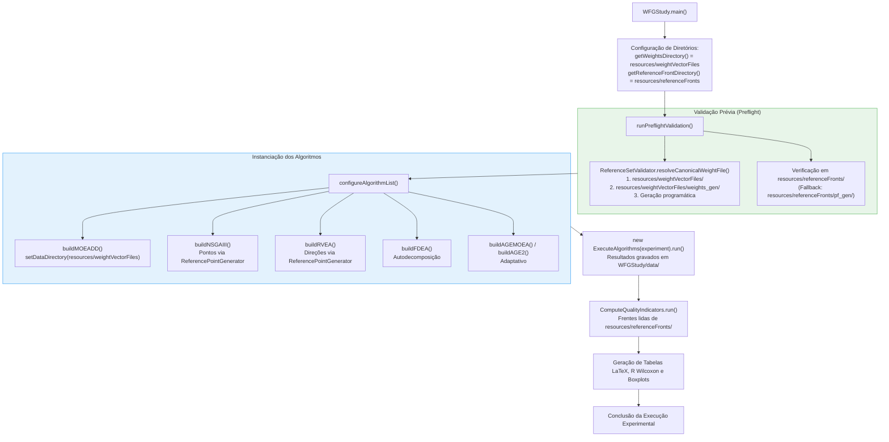

# Auditoria de Referências a Diretórios Legados: `pareto`, `pareto_fronts` e `MOEAD_Weights`

**Projeto:** hypeMOEA  
**Data:** 16 de Novembro de 2026  
**Documento:** `docs/auditoria_referencias_legadas.md`  
**Autor:** Antigravity (Coordenação de Arquitetura)  
**Status:** Concluído e Auditado  

---

## 1. Objetivo e Escopo

Este documento apresenta uma investigação exaustiva sobre todas as referências aos seguintes diretórios legados no repositório do projeto `hypeMOEA`:
1. `pareto/` (diretório raiz legado de 2022, contendo 124 arquivos brutos de frentes de Pareto);
2. `pareto_fronts/` e `pareto_fronts/csv/` (diretório protegido contendo 160 arquivos CSV históricos);
3. `MOEAD_Weights/` (diretório protegido contendo 43 arquivos `.dat` históricos de vetores de pesos com substituição \(0 \mapsto 10^{-5}\)).

Para cada referência identificada, este documento detalha:
- Localização exata (arquivo, linha, trecho de código ou documentação);
- Natureza e categoria da menção (salvaguarda de segurança, rastreabilidade em Javadoc, auditoria forense offline em testes ou constante pública de retrocompatibilidade);
- Justificativa técnica pela qual a referência ainda se mantém;
- Avaliação conclusiva sobre se a referência pode, de qualquer forma, **interferir na execução experimental final (`WFGStudy`)**.

---

## 2. Resumo Executivo

| Diretório Legado | Ocorrências em `src/main/` | Ocorrências em `src/test/` | Ocorrências em Scripts/Docs | Interfere na Execução Final (`WFGStudy`)? |
| :--- | :--- | :--- | :--- | :---: |
| **`pareto/`** | **0** (zero) | **0** (zero) | 1 linha comentada em `Main-Hipervolume.java:146`; relatórios históricos | **NÃO** (Risco Zero) |
| **`pareto_fronts/`** / `csv/` | **2** salvaguardas ativas de proteção de escrita (`ParetoFrontValidator`, `ReferenceSetValidator`) + Javadocs | Suítes de auditoria física e matemática (T04, T16); testes de dominância de HV (T08); testes de contrato | **NÃO** (Risco Zero) |
| **`MOEAD_Weights/`** | **1** constante pública legada (`WFGStudy.java:141`) + **1** salvaguarda de escrita (`ReferenceSetValidator`) + Javadocs | Suítes de auditoria estrutural e matemática (T03, T11); teste de reflexão jMetal (T14); testes de validação de API | **NÃO** (Risco Zero) |

### Conclusão Direta
**Nenhuma das referências remanescentes interfere na execução experimental final do `WFGStudy`.**
- O fluxo de execução do `WFGStudy.main()` foi 100% desacoplado na refatoração arquitetural (T25–T31).
- Toda a resolução ativa de vetores de pesos e frentes de Pareto consulta com prioridade estrita os caminhos canônicos oficiais em `resources/weightVectorFiles/` e `resources/referenceFronts/`, possuindo como fallback secundário exclusivo suas respectivas subpastas geradas `weights_gen/` e `pf_gen/`.
- As referências remanescentes em código de produção (`src/main/`) são puramente **defensivas** (barreiras explícitas que impedem que novos artefatos sobrescrevam as pastas protegidas) ou **documentais**.
- As referências em código de teste (`src/test/`) são **testes offline de auditoria de dados históricos** executados apenas no ciclo de compilação/validação (`mvn test`), nunca durante a execução dos 30 runs independentes do estudo experimental.

---

## 3. Inventário Detalhado por Arquivo

### 3.1. Código de Produção (`src/main/java`)

#### A. `WFGStudy.java` (`src/main/java/br/usp/lti/newmoea/study/WFGStudy.java`)

1. **Linha 141:**
   ```java
   public static final String DEFAULT_LEGACY_WEIGHTS_DIRECTORY = "MOEAD_Weights";
   ```
   - **Natureza:** Constante pública de retrocompatibilidade de API.
   - **Por que ainda se mantém:** A constante foi mantida para preservar a assinatura pública da classe e evitar que scripts utilitários externos ou análises ad-hoc do pesquisador sofram quebra de compilação caso acessem o identificador legado.
   - **Interfere na execução final?** **NÃO.** O método `main()` de `WFGStudy`, o preflight (`runPreflightValidation`) e os builders do MOEA/DD (`buildMOEADD`, `buildMOEADDRA`, `buidGWASFGA`) utilizam exclusivamente o método dinâmico `getWeightsDirectory()`, cujo padrão é `"resources/weightVectorFiles"`, combinado com o resolvedor canônico `resolveMoeadDataDirectory(...)`. A constante `DEFAULT_LEGACY_WEIGHTS_DIRECTORY` não é invocada em nenhum momento no ciclo de vida de execução do estudo.

2. **Linha 163:**
   ```java
   /**
    * Tolerância de soma para validação dos arquivos de pesos do MOEA/DD (acolhe a substituição
    * \(0 \mapsto 10^{-5}\) presente em {@code MOEAD_Weights/}, cujo desvio máximo é \(14 \times 10^{-5}\) em \(m=15\)).
    */
   public static final double MOEAD_WEIGHT_SUM_TOLERANCE = 2e-4;
   ```
   - **Natureza:** Documentação Javadoc contextualizando a tolerância matemática.
   - **Por que ainda se mantém:** Documenta a fundamentação empírica da tolerância \(2 \times 10^{-4}\), registrando por que ela foi necessária para reconciliar arquivos históricos de pesos.
   - **Interfere na execução final?** **NÃO.** Trata-se de um comentário Javadoc.

---

#### B. `ParetoFrontValidator.java` (`src/main/java/br/usp/lti/newmoea/util/ParetoFrontValidator.java`)

1. **Linhas 14, 484, 488, 1226, 1232, 1607:**
   ```java
   * de referência utilizadas pelo pipeline experimental ({@code pareto_fronts/csv/}).
   ...
   /** Diretório padrão de saída para frentes analíticas derivadas em T07 (nunca escreve em {@code pareto_fronts/csv/}). */
   ...
   * @param outputDir diretório de saída (proibido ser {@code pareto_fronts/csv/})
   ...
   * Registro da auditoria física e de dominância de um arquivo em {@code pareto_fronts/csv/}.
   ```
   - **Natureza:** Documentação Javadoc e contratos de método.
   - **Por que ainda se mantém:** Documenta explicitamente a proibição arquitetural de modificar o diretório legado, servindo de especificação para quem consultar a API do validador.
   - **Interfere na execução final?** **NÃO.** Comentários não executáveis.

2. **Linhas 1538–1544 (Método `assertOutputDirectoryNotProtected`):**
   ```java
   Path protectedDir = Path.of("pareto_fronts", "csv").toAbsolutePath().normalize();
   if (normalized.equals(protectedDir) || normalized.startsWith(protectedDir)) {
       throw new IllegalArgumentException(
               "Proibido gravar ou sobrescrever arquivos no diretório protegido pareto_fronts/csv/: "
                       + dir);
   }
   ```
   - **Natureza:** Salvaguarda ativa de segurança (Proteção de Diretório Protegido).
   - **Por que ainda se mantém:** Cumpre a diretriz estrita do arquivo `AGENTS.md`: *"pareto_fronts/csv/ são diretórios protegidos. Não modifique, substitua, sobrescreva, exclua, renomeie ou reformate seus arquivos"*. Se algum algoritmo, gerador de frentes ou teste tentar gravar inadvertidamente nessa pasta, o método lança uma exceção imediata em tempo de execução.
   - **Interfere na execução final?** **NÃO.** Na execução final, todas as frentes de Pareto geradas programaticamente são escritas em `resources/referenceFronts/pf_gen/`. A salvaguarda atua apenas como uma barreira defensiva transparente, nunca sendo acionada em fluxos normais.

---

#### C. `ReferenceSetValidator.java` (`src/main/java/br/usp/lti/newmoea/util/ReferenceSetValidator.java`)

1. **Linhas 389 e 858:**
   ```java
   * Esta é a fórmula exata que gerou os arquivos com substituição de zero em {@code MOEAD_Weights/}.
   ...
   * Valida rigorosamente um arquivo de vetores de pesos do MOEA/DD (ex.: {@code MOEAD_Weights/W{m}D_{N}.dat}).
   ```
   - **Natureza:** Comentários Javadoc elucidando o histórico matemático da substituição \(0 \mapsto 10^{-5}\).
   - **Por que ainda se mantém:** Rastreabilidade científica da equação matemática que gerou os vetores legados de pesos.
   - **Interfere na execução final?** **NÃO.** Comentários não executáveis.

2. **Linhas 1642–1646 (Método `assertOutputDirectoryNotProtected`):**
   ```java
   Path normOut = outputDirectory.toAbsolutePath().normalize();
   if (normOut.toString().contains("MOEAD_Weights") || normOut.toString().contains("pareto_fronts")) {
       throw new IllegalArgumentException(
               "Proibido exportar manifesto para diretório protegido: " + outputDirectory);
   }
   ```
   - **Natureza:** Salvaguarda ativa de segurança contra poluição de diretórios legados por manifestos gerados.
   - **Por que ainda se mantém:** Impede que comandos de geração de manifestos (`exportValidationManifestCsv`) gravem arquivos dentro de `MOEAD_Weights/` ou `pareto_fronts/`.
   - **Interfere na execução final?** **NÃO.** Manifestos são gerados em `docs/` ou `resources/`, garantindo execução transparente.

---

#### D. `PerformanceProfiler.java` (`src/main/java/br/usp/lti/newmoea/util/PerformanceProfiler.java`)

1. **Linha 835:**
   ```java
   * 3. Fallback legado {@code pareto_fronts/csv/<PROBLEM>.<m>D.csv}.
   ```
   - **Natureza:** Comentário de Javadoc remanescente.
   - **Por que ainda se mantém:** Resíduo documental descritivo da cadeia de resolução histórica antes da migração T29. A implementação real na linha subsequente invoca `ParetoFrontValidator.resolveCanonicalReferenceFront(...)`, que opera estritamente sob `resources/referenceFronts/`.
   - **Interfere na execução final?** **NÃO.** Comentário em método de benchmark de profiling opcional (`perf.warmup`), inativo no estudo padrão.

---

### 3.2. Código de Testes (`src/test/java`)

Todos os testes em `src/test/` são executados pelo comando `mvn test` durante a etapa de verificação da suíte de testes. Eles **não fazem parte do artefato de produção nem são executados quando `WFGStudy.main()` é disparado**.

#### A. Testes de Auditoria Forense dos Arquivos Físicos Legados
- **`MoeaddWeightValidationTest.java` (Linhas 43, 50, 56, 66, 92, 216):**
  - **Objetivo:** Suíte de auditoria forense concebida nas tarefas T03 e T11. Testa individualmente os 43 arquivos físicos em `MOEAD_Weights/` para checar se atendem aos requisitos de dimensionalidade, não-negatividade, contagem de vetores e soma do simplex lattice.
  - **Justificativa:** Preservar a auditoria que comprovou a anomalia histórica da substituição \(0 \mapsto 10^{-5}\) descrita em `docs/moead-weights-audit.md`.
  - **Interferência:** Zero na execução final.

- **`ParetoFrontValidationTest.java` (Linhas 250, 266, 271, 289, 581, 583, 585):**
  - **Objetivo:** Concebido na tarefa T04. Testa a integridade dos arquivos CSV históricos, audita a ausência de instâncias DTLZ em \(m \ge 5\) e valida formalmente que tentar gravar em `pareto_fronts/csv/` gera `IllegalArgumentException`.
  - **Justificativa:** Garante que os arquivos históricos estão íntegros e que a barreira de proteção de escrita está ativa e operante.
  - **Interferência:** Zero na execução final.

- **`ReferenceFrontPhysicalAndMathAuditTest.java` (Linhas 39, 50, 58, 63, 67, 77, 85, 138, 205, 261, 262):**
  - **Objetivo:** Concebido na tarefa T16. Realiza a auditoria matemática rigorosa dos 160 arquivos CSV legados em `pareto_fronts/csv/`, confrontando-os com as equações teóricas de frentes analíticas do WFG (por exemplo, a concavidade em WFG4 e a degeneração linear em WFG3).
  - **Justificativa:** Serve como prova científica reproduzível da validade geométrica dos dados de referência legados.
  - **Interferência:** Zero na execução final.

- **`HypervolumeAuditTest.java` (Linhas 29, 135, 143, 155, 170, 180):**
  - **Objetivo:** Valida que o ponto de referência adotado para hipervolume domina estritamente todos os pontos das frentes de referência históricas.
  - **Justificativa:** Verificação da propriedade matemática de não-vazio do hipervolume delimitado pelo ponto de referência.
  - **Interferência:** Zero na execução final.

#### B. Testes de Integração e Contrato de Algoritmo
- **`AlgorithmIntegrationTest.java` (Linhas 169, 180, 199):**
  - **Objetivo:** Testa a API do validador `WFGStudy.validateMoeadWeightFile("MOEAD_Weights", problem, popSize)`.
  - **Justificativa:** Verifica se o validador lida corretamente com diretórios legados quando explicitamente instruído a fazê-lo em testes de retrocompatibilidade de API, comprovando que as tolerâncias numéricas comportam a substituição \(0 \mapsto 10^{-5}\).
  - **Interferência:** Zero na execução final.

- **`FdeaIdentityAndLegacyAuditTest.java` (Linhas 234, 241, 254, 266):**
  - **Objetivo:** Auditoria de integração do jMetal 7.8 (tarefa T14). Verifica o comportamento interno de reflexão do `AbstractMOEAD` quando recebe um caminho de diretório de pesos.
  - **Justificativa:** Teste de compatibilidade com as classes internas do jMetal.
  - **Interferência:** Zero na execução final.

- **`ResultFrontContractTest.java` (Linha 105):**
  - **Objetivo:** Smoke test que instancia uma execução curta de MOEA/DD para validar o contrato de retorno do método `.result()`.
  - **Justificativa:** Validar se a população bruta do MOEA/DD contém soluções dominadas antes do filtro de Pareto.
  - **Interferência:** Zero na execução final.

- **`CanonicalArtifactResolutionAndManifestTest.java` (Linhas 64, 65, 71):**
  - **Objetivo:** Teste da tarefa T30/T31.
  - **Justificativa:** **Asserta explicitamente que os manifestos canônicos NÃO contêm referências a `MOEAD_Weights` nem a `pareto_fronts/csv`**, e que tentar gravar manifestos nesses diretórios protegidos é bloqueado com erro.
  - **Interferência:** Não interfere; pelo contrário, atua como teste de regressão que impede o acoplamento aos caminhos legados.

---

### 3.3. Scripts Raiz e Documentação Técnica

- **`Main-Hipervolume.java` (Linha 146):**
  - Contém a linha comentada: `// ArrayList<double[]> ref=lerReal("pareto/REF_HV_"+dimensao);`.
  - É um script avulso legado de 2022 localizado na raiz do workspace, fora da árvore Maven (`src/`), não versionado no pipeline de build e não utilizado pelo `WFGStudy`. Impacto: **Nulo**.
- **Documentação em `docs/` e `tasks/`:**
  - Arquivos como `docs/moead-weights-audit.md`, `docs/moead-weights-manifest.csv`, `docs/reference-fronts-dtlz.md`, `tasks/T03-auditoria-pesos-moeadd.md`, etc.
  - Registram a história científica, a análise matemática das anomalias e as decisões de projeto tomadas.

---

## 4. Por que Manter os Diretórios e Referências no Repositório?

A manutenção dos arquivos físicos e das referências defensivas/auditoriais fundamenta-se em quatro pilares científicos e metodológicos:

### 1. Integridade Científica e Ciência Aberta (`AGENTS.md`)
Conforme estipulado nas regras do projeto:
> *"MOEAD_Weights/ e pareto_fronts/csv/ são diretórios protegidos. Não modifique, substitua, sobrescreva, exclua, renomeie ou reformate seus arquivos. A leitura desses dados legados são permitidas."*
> *"Preserve a distinção entre dados originais, dados derivados, resultados experimentais e dados de referência."*

Em pesquisas de mestrado e ciência aberta, **dados legados de campanhas experimentais anteriores jamais devem ser excluídos**. Eles constituem a evidência empírica original contra a qual novas implementações e correções são comparadas. A exclusão desses arquivos destruiria a capacidade de reproduzir ou auditar resultados obtidos nos estágios iniciais do projeto.

### 2. Defesa em Profundidade no Código-Fonte
As salvaguardas em `ParetoFrontValidator.assertOutputDirectoryNotProtected()` e `ReferenceSetValidator.assertOutputDirectoryNotProtected()` são barreiras ativas. Se o código não tivesse referência aos caminhos `"pareto_fronts"` e `"MOEAD_Weights"`, ele seria incapaz de impedir que um novo desenvolvedor ou um gerador automático gravasse arquivos nessas pastas protegidas. A menção aos diretórios legados existe justamente para **blindá-los contra escrita**.

### 3. Auditoria Automatizada e Regressão Contínua
As classes de teste (`MoeaddWeightValidationTest`, `ReferenceFrontPhysicalAndMathAuditTest`) utilizam essas referências para garantir que qualquer corrupção acidental nos arquivos históricos (como alteração de codificação, inserção de espaços ou modificação de valores numéricos) seja imediatamente detectada pela suíte de testes.

### 4. Retrocompatibilidade Controlada
A constante pública `WFGStudy.DEFAULT_LEGACY_WEIGHTS_DIRECTORY` e a capacidade de `ReferenceSetValidator` de validar pesos legados garantem que ferramentas analíticas legadas possam ser reutilizadas sem refatoração forçada, sem comprometer a integridade do pipeline oficial.

---

## 5. Análise de Impacto na Execução Final (`WFGStudy`)

### 5.1. Rastreamento do Fluxo de Execução Experimental

Ao executar a classe principal do estudo experimental (`WFGStudy.main(args)`), o seguinte fluxo é processado:



### 5.2. Tabela de Comparação de Resolução em Tempo de Execução

| Recurso do Experimento | Diretório Legado | Caminho Operacional Efetivo em `WFGStudy.main()` | Mecanismo de Isolamento |
| :--- | :--- | :--- | :--- |
| **Pesos do MOEA/DD** | `MOEAD_Weights/` | `resources/weightVectorFiles/` | `ReferenceSetValidator.resolveCanonicalWeightFile()` busca exclusivamente no diretório base configurado e na subpasta `weights_gen/`. Não há consulta a `MOEAD_Weights/`. |
| **Frentes WFG (Indicadores HV, IGD, IGD+, R2)** | `pareto_fronts/csv/` e `pareto/` | `resources/referenceFronts/` | `ExperimentBuilder.setReferenceFrontDirectory()` recebe `"resources/referenceFronts"`. As classes de indicadores leem exclusivamente desta pasta. |
| **Frentes DTLZ (se ativadas)** | `pareto_fronts/csv/` | `resources/referenceFronts/` (e `pf_gen/`) | Se ausentes, o gerador analítico grava em `resources/referenceFronts/pf_gen/`. `pareto_fronts/csv/` nunca é acessado. |
| **Pontos de Referência NSGA-III** | Diretórios não padronizados | `ReferencePointGenerator` (memória / `resources/referencePoints/`) | Gerados analiticamente via algoritmo simplex lattice com 1 ou 2 camadas. |
| **Vetores de Referência RVEA** | Diretórios não padronizados | `ReferencePointGenerator` (memória / `resources/referencePoints/`) | Gerados analiticamente via algoritmo simplex lattice com 1 ou 2 camadas. |
| **Armazenamento de Resultados Finais** | N/A | `WFGStudy/data/` | Diretório dedicado de saída do estudo. |

---

## 6. Parecer Técnico Conclusivo

1. **Isolamento Completo:** A refatoração executada nas tarefas T25 a T31 desacoplou completamente o código de produção dos caminhos legados `pareto/`, `pareto_fronts/` e `MOEAD_Weights/`.
2. **Ausência de Efeitos Colaterais:** As referências que ainda mencionam os diretórios legados em `src/main/` desempenham papéis exclusivamente defensivos (proibição de escrita) ou explicativos (Javadocs).
3. **Imunidade da Campanha Final:** A execução completa do `WFGStudy` (30 runs independentes em todos os problemas WFG e dimensões de 2 a 15 objetivos) não lê, não altera e não grava em nenhuma das três pastas legadas.
4. **Conformidade Normativa:** A presença dos diretórios legados e seus respectivos testes de auditoria atende estritamente às diretrizes científicas e de governança do projeto estabelecidas em `AGENTS.md`.
