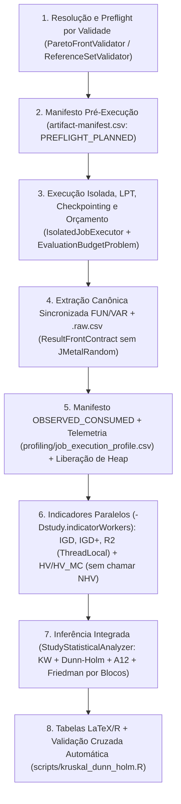

# Pipeline de Execução e Pós-Processamento Experimental (`hypeMOEA`)

Este documento descreve a arquitetura integrada e ativa do pipeline experimental em [WFGStudy.java](file:///c:/Users/vyctor922/Downloads/Mestrado/tema/experimento/java/hypeMOEA/src/main/java/br/usp/lti/newmoea/study/WFGStudy.java) sobre **Java 21 (LTS)** e **jMetal 7.8**, cobrindo desde a validação pré-voo de artefatos canônicos até a execução isolada por orçamento/semente, o cálculo de indicadores com proteção de hipervolume e o pós-processamento estatístico integrado (Java + validação cruzada em R base 4.6.2).

---

## 1. Visão Geral da Arquitetura do Experimento (`WFGStudy`)

O estudo experimental compara os **6 MOEAs/MaOEAs principais** nas suítes **WFG1–WFG9** e **DTLZ1–DTLZ7** para $m \in \{2, 3, 5, 8, 10, 15\}$ objetivos, com `INDEPENDENT_RUNS = 30` execuções independentes por par `(algoritmo, problema_m)`:

1. **`NSGAIII`** (`org.uma.jmetal.algorithm.multiobjective.nsgaiii.NSGAIII`)
2. **`MOEADD`** (`EvaluationBudgetProblem.BudgetCompliantMOEADD` sobre `org.uma.jmetal.algorithm.multiobjective.moead.MOEADD`)
3. **`FDEA`** ([FDEA.java](file:///c:/Users/vyctor922/Downloads/Mestrado/tema/experimento/java/hypeMOEA/src/main/java/br/usp/lti/newmoea/algorithm/fdea/FDEA.java))
4. **`RVEA`** (`org.uma.jmetal.component.algorithm.multiobjective.RVEABuilder`)
5. **`AGE-MOEA`** (`org.uma.jmetal.algorithm.multiobjective.agemoea.AGEMOEA`)
6. **`AGE-MOEA-II`** (`org.uma.jmetal.algorithm.multiobjective.agemoeaii.AGEMOEAII`)

### Fluxo Integrado de Etapas em `WFGStudy.main()`



---

## 2. Etapa 1: Validação Pré-Voo, Resolução Canônica e Manifesto Efetivo (`T34`)

Antes de executar qualquer algoritmo, `WFGStudy.runPreflightValidationAndResolveArtifacts`:
1. **Resolve frentes de Pareto por validade de conteúdo** ([ParetoFrontValidator.java](file:///c:/Users/vyctor922/Downloads/Mestrado/tema/experimento/java/hypeMOEA/src/main/java/br/usp/lti/newmoea/util/ParetoFrontValidator.java)):
   - **Prioridade 1 (`OFFICIAL`):** `resources/referenceFronts/<PROBLEM>.<m>D.csv` (ou override `-Dstudy.referenceFrontDirectory`). Quando `-Dstudy.restoreOfficialJMetalResources=true` (`false` por padrão), caso o arquivo oficial esteja ausente ou corrompido, tenta restaurá-lo atomicamente da tag oficial `jmetal-7.8` no GitHub (`jMetal/jMetal`) antes de avançar para a Prioridade 2.
   - **Prioridade 2 (`PF_GEN`):** `resources/referenceFronts/pf_gen/<PROBLEM>.<m>D.csv` (zeros analíticos puros preservados).
   - **Prioridade 3 (`ANALYTICAL`):** Geração matemática sob demanda para `DTLZ1–DTLZ7` e `WFG1–WFG9` (respeitando as geometrias distintas de Huband et al., 2006), publicada atomicamente com trava por caminho.
   - Variantes com substituição `0.0 -> 1e-5` ficam isoladas em `pf_lowzero_gen/` apenas quando `-DreplaceZeroFronts` estiver ativa (`false` por padrão).
2. **Resolve vetores de pesos do `MOEA/DD`** ([ReferenceSetValidator.java](file:///c:/Users/vyctor922/Downloads/Mestrado/tema/experimento/java/hypeMOEA/src/main/java/br/usp/lti/newmoea/util/ReferenceSetValidator.java)):
   - **Prioridade 1 (`OFFICIAL`):** `resources/weightVectorFiles/W<m>D_<N>.dat` (ou override `-Dstudy.weightsDirectory`). Quando `-Dstudy.restoreOfficialJMetalResources=true` (`false` por padrão), caso o arquivo oficial esteja ausente/corrompido, restaura-o atomicamente a partir do espelho local `moead/` ou da tag oficial `jmetal-7.8` no GitHub (`jMetal/jMetal`), validando o SHA-256 contra `docs/moead-weights-manifest.csv`.
   - **Prioridade 2/3 (`WEIGHTS_GEN`):** `resources/weightVectorFiles/weights_gen/W<m>D_<N>.dat` (geração analítica pura em duas camadas preservando `0.0`, ex.: `W5D_210.dat` e `W15D_135.dat`).
   - Variantes `0.0 -> 1e-5` ficam isoladas em `weights_lowzero_gen/` apenas quando `-DreplaceZeroWeights` estiver ativa (`false` por padrão).
   - Política opcional em memória (`-Dstudy.allowMoeadWeightsInMemory=false` por padrão): quando `true`, dispensa arquivo físico apenas para `MOEA/DD` em $m=2, 2 \le N \le 300$, registrando `NONE_IN_MEMORY` sem fabricar caminho fictício.
   - **Nunca** acessa os diretórios legados protegidos (`MOEAD_Weights/`, `pareto_fronts/`, `pareto/`) nem a cópia externa modificada do jMetal.
3. **Exporta `<outputDir>/artifact-manifest.csv`** antes da execução (`PREFLIGHT_PLANNED:*`) e atualiza após o término (`OBSERVED_CONSUMED:*` ou `OBSERVED_EXECUTION_FAILED:*`).

---

## 3. Etapa 2: Execução Isolada, Checkpointing Incremental, LPT e Orçamento Estrito

A execução dos jobs em `WFGStudy.main()` utiliza [IsolatedJobExecutor.java](file:///c:/Users/vyctor922/Downloads/Mestrado/tema/experimento/java/hypeMOEA/src/main/java/br/usp/lti/newmoea/util/IsolatedJobExecutor.java), [EvaluationBudgetProblem.java](file:///c:/Users/vyctor922/Downloads/Mestrado/tema/experimento/java/hypeMOEA/src/main/java/br/usp/lti/newmoea/util/EvaluationBudgetProblem.java) e [ResultFrontContract.java](file:///c:/Users/vyctor922/Downloads/Mestrado/tema/experimento/java/hypeMOEA/src/main/java/br/usp/lti/newmoea/util/ResultFrontContract.java):

- **Orçamento equitativo $B_{\text{target}} = N_{\text{config}}(m) \times G_{\max}(m, \text{problema})$:** Todos os 6 algoritmos (incluindo `NSGA-III` e `AGE-MOEA`/`II`, que alocam $N_{\text{alloc}}$ múltiplo de 4 ou par) avaliam exatamente $B_{\text{target}}$ soluções reais, integrando no último lote apenas os candidatos efetivamente avaliados (sem objetivos copiados/fictícios e rejeitando $B < N_{\text{alloc}}$).
- **Independência, fila LPT e reconstrução sem RNG:** Cada tupla `(baseSeed, problem, m, algorithm, runId)` recebe uma semente única de 64 bits (`SplitMix64`) aplicada sob `JMETAL_RANDOM_LOCK` (ou em subprocesso JVM dedicado via `-Dstudy.processIsolation=true`, recebendo flags opcionais via `-Dstudy.workerJvmArgs`). Quando `-Dstudy.parallelWorkers > 1` (e salvo `-Dstudy.lptScheduling=false`), `orderJobSpecsLpt` despacha primeiro os jobs mais pesados (`m >= 8`, `AGE-MOEA`/`II`, `FDEA`) sem alterar resultados determinísticos. Na persistência e auditoria pós-execução, `ResultFrontContract.createUnseededSolution` reconstrói `DoubleSolution` sem invocar `JMetalRandom.getInstance()`, eliminando interferência sobre o gerador singleton mesmo sob concorrência.
- ***Checkpointing* incremental job-a-job e retomada íntegra:** Conforme cada worker conclui no `ExecutorCompletionService`, `FUN<r>.csv`, `VAR<r>.csv` e `.raw.csv` são gravados imediatamente no disco e os arrays `double[][]` são liberados do Heap via `JobExecutionResult.compactRetainingMetadataOnly()` (e `batchReport = null` antes dos indicadores), preservando apenas escalares e hashes para `profiling/job_execution_profile.csv`. Um journal incremental `run_manifest.checkpoint.csv` sofre *flush* por job e consolida `run_manifest.csv` atomicamente a cada `-Dstudy.checkpointInterval` jobs (`25` por padrão) e ao término do lote. Em retomadas pós-queda, `reconcileCheckpointJournalIfPresent` ignora apenas eventual última linha truncada e `verifyExistingRunForResume` mantém verificação física completa de hashes SHA-256 e alinhamento `VAR -> FUN`, disparando `CorruptedRunArtifactException` diante de qualquer corrupção.
- **Coleta geracional opt-in de $R^2$ (`-Dstudy.enableR2Observer=false` por padrão):** Quando habilitada (`true`), instancia um `R2ExecutionObserver` isolado por run e exporta `data/<ALG>/<PROB>/R2_trace_run<r>.csv` sem acrescentar avaliações da função objetivo.

---

## 4. Etapa 3: Normalização Teórica, Indicadores Paralelos e Hipervolume Seguro (`T35` / Fase 6)

No estágio atual (pré-execução final antes da integração das hiper-heurísticas):
- **`NHV` não possui bloqueio em código**, permanecendo inativa nesta fase apenas por **não ser chamada** nas configurações ativas (`-Dstudy.hvMethods=PISA,MC` ou `-Dstudy.hvMethodsByM=<=5:PISA,MC;>=8:MC`). Caso explicitamente incluída, `hvRefUnit` é avaliado uma única vez por problema antes do despacho paralelo e `NHV` é derivada via `ObjectiveNormalizationContract.deriveNormalizedHypervolumeO1`.
- **Paralelismo seguro por thread:** `computeContractualIndicatorsAndExport` avalia todas as frentes pendentes em `ExecutorCompletionService` (padrão de threads igual a `study.parallelWorkers`), isolando instâncias de `InvertedGenerationalDistance`, `InvertedGenerationalDistancePlus` e `R2` em `ThreadLocal<IndicatorCalculators>` por problema (mitigando a mutação de estado interno em `R2.compute` no jMetal 7.8), com ordenação *heaviest-first* e limpeza explícita no `finally` (`calculators.remove()`). Subprocessos pesados `ExactHypervolumeWorker` (`PISA`/`WFG`/`NHV`) são limitados por semáforos dedicados (`lowDimExactPermits` para $m \le 5$; `highDimExactPermits` limitado por padrão a $\min(\text{workers}, 2)$ para $m \ge 8$) contra explosão de RAM, enquanto a gravação final preserva estritamente a ordem canônica em `QualityIndicatorSummary.csv` e `hv_audit_manifest.csv`.
- **Normalização comum (`THEORETICAL_PARETO_BOUNDS`):** [ObjectiveNormalizationContract.java](file:///c:/Users/vyctor922/Downloads/Mestrado/tema/experimento/java/hypeMOEA/src/main/java/br/usp/lti/newmoea/util/ObjectiveNormalizationContract.java) normaliza objetivos pelos limites analíticos exatos da frente verdadeira ($[0, 2j]$ em `WFG1–9`, $[0, 0.5]$ em `DTLZ1`, $[0, 1]$ em `DTLZ2–6`, $[0, 1]^{m-1} \times [0, 2m]$ em `DTLZ7`), sem clipping silencioso em `IGD`, `IGD+` e `R2`, e avalia o hipervolume na mesma caixa normalizada $[\mathbf{0}, \tilde{\mathbf{r}}]$ ($\tilde{\mathbf{r}} = T(\mathbf{r}_{\text{raw}})$).
- **Dupla série de Hipervolume e Fallback Generalizado ([ProcessIsolatedHypervolumeExecutor.java](file:///c:/Users/vyctor922/Downloads/Mestrado/tema/experimento/java/hypeMOEA/src/main/java/br/usp/lti/newmoea/util/ProcessIsolatedHypervolumeExecutor.java)):**
  - Configurável via `-Dstudy.hvMethods` (padrão `PISA,MC`), opcionalmente por faixa de objetivos via `-Dstudy.hvMethodsByM` (opt-in desativado por padrão; ex.: `<=5:PISA,MC;>=8:MC`), `-Dperf.hvTimeoutMs=3600000` (60 min), `-Dstudy.hvMcSamples=1000000` ($10^6$ amostras) e `-Dstudy.workerJvmArgs` (flags JVM exclusivas dos workers com validação *fail-fast*).
  - **`HV` (`PISA`) / `HV_WFG` (`WFG`):** executados em subprocesso JVM isolado ([ExactHypervolumeWorker.java](file:///c:/Users/vyctor922/Downloads/Mestrado/tema/experimento/java/hypeMOEA/src/main/java/br/usp/lti/newmoea/util/ExactHypervolumeWorker.java)) sobre a mesma caixa $[\mathbf{0}, \tilde{\mathbf{r}}]$. Em caso de timeout ou falha, o worker e seus descendentes são encerrados forçadamente e o valor exato é gravado como `NA` (**jamais `0.0`**).
  - **`HV_MC` ([MonteCarloHypervolume.java](file:///c:/Users/vyctor922/Downloads/Mestrado/tema/experimento/java/hypeMOEA/src/main/java/br/usp/lti/newmoea/util/MonteCarloHypervolume.java)):** série aproximada uniforme calculada com semente determinística (`deriveDeterministicMcSeed` com `SplittableRandom` local), erro padrão e IC de Wilson a 95%. Quando `MC` já integra `study.hvMethods`, eventual timeout do exato **reutiliza o `HV_MC` já calculado sem recomputar**.
  - **Opção ligar/desligar `-Dstudy.hvFallbackToMcOnAllExactTimeout` (`true` por padrão):** quando `study.hvMethods` contém **apenas** hipervolumes pesados (`PISA`, `WFG` ou `PISA,WFG`, sem `MC`) e **todos** atingem timeout/falha, o fallback `MonteCarloHypervolume` é executado **exatamente 1 vez** (gravando `HV_FALLBACK_MC` + `<outputDir>/hv_fallback_warnings.md` e auditoria completa em `<outputDir>/hv_audit_manifest.csv`). Se configurada como `false`, nenhum fallback MC é disparado e o resultado permanece `NA`.

---

## 5. Etapa 4: Pós-Processamento Estatístico Integrado e Validação em R (`T36`)

Executado automaticamente ao final de `WFGStudy.main()` por [StudyStatisticalAnalyzer.java](file:///c:/Users/vyctor922/Downloads/Mestrado/tema/experimento/java/hypeMOEA/src/main/java/br/usp/lti/newmoea/statistics/StudyStatisticalAnalyzer.java):

1. **Inferência por Célula `(problema, m, indicador)` (`statistics/kruskal_wallis_cells.csv` e `statistics/dunn_holm_posthoc_pairs.csv`):**
   - Aplica [KruskalWallisTest.java](file:///c:/Users/vyctor922/Downloads/Mestrado/tema/experimento/java/hypeMOEA/src/main/java/br/usp/lti/newmoea/statistics/KruskalWallisTest.java) + [DunnPostHocTest.java](file:///c:/Users/vyctor922/Downloads/Mestrado/tema/experimento/java/hypeMOEA/src/main/java/br/usp/lti/newmoea/statistics/DunnPostHocTest.java) (com mid-ranks, correção de empates, proteção para $C=0$ e ajuste sequencial de Holm) e orienta $\hat{A}_{12}$ conforme a direção de otimização (`MAXIMIZE` em `HV`/`HV_WFG`/`HV_MC`; `MINIMIZE` em `IGD`/`IGD+`/`R2`).
   - Classifica explicitamente a disponibilidade de cada célula (`COMPLETE`, `PARTIAL_MISSING_EXACT`, `UNAVAILABLE_ALL_NA`, `INSUFFICIENT_RUNS_FOR_INFERENCE`), sem jamais preencher `NA` do exato com valores de Monte Carlo.
2. **Comparação Global entre Problemas (`statistics/friedman_global_blocks.csv` e `latex/Phase5StatisticalSummary.tex`):**
   - Teste de Friedman por blocos (onde cada bloco é a mediana de uma célula completa `problemTag`, evitando pseudo-replicação) com estatística $F_F$ de Iman–Davenport.
3. **Tabelas Auxiliares jMetal (`latex/<experimentName>.tex`, `latex/FriedmanTest*.tex`, `R/*.R`):**
   - Geradas automaticamente para todos os indicadores completos sem `NA`, suportando inclusive diretórios de saída aninhados (`WFGStudy/tests/...`) via `WFGStudy.resolveStudyOutputLayout`.
4. **Validação Cruzada Automática contra R Base ([scripts/kruskal_dunn_holm.R](file:///c:/Users/vyctor922/Downloads/Mestrado/tema/experimento/java/hypeMOEA/scripts/kruskal_dunn_holm.R)):**
   - Implementação 100% autocontida em R base nativo (`stats::kruskal.test`, fórmula analítica exata de Dunn com correção de empates e `stats::p.adjust(..., method = "holm")`, sem exigir o pacote externo CRAN `dunn.test`).
   - `StudyStatisticalAnalyzer` localiza automaticamente `Rscript` via `-Dstudy.rscriptPath`, `PATH` ou instalação padrão (ex.: `C:\Program Files\R\R-4.6.2\bin\Rscript.exe` no Windows ou `/usr/bin/Rscript` no Linux), gerando `statistics/r_vs_java_validation.csv` e `statistics/r_validation_status.txt` (sem falhar caso `Rscript` esteja ausente).

### Comandos Úteis de Pós-Processamento Manual

* **No Windows `CMD` (`cmd.exe`)**:
```bash
REM 1. Executar o modo fixture de validação do script R
"C:\Program Files\R\R-4.6.2\bin\Rscript.exe" scripts/kruskal_dunn_holm.R --fixture

REM 2. Executar validação cruzada manual R vs Java sobre um diretório de estudo
"C:\Program Files\R\R-4.6.2\bin\Rscript.exe" scripts/kruskal_dunn_holm.R ^
  --summary-csv WFGStudy/QualityIndicatorSummary.csv ^
  --java-kw-csv WFGStudy/statistics/kruskal_wallis_cells.csv ^
  --java-dunn-csv WFGStudy/statistics/dunn_holm_posthoc_pairs.csv ^
  --output-comparison-csv WFGStudy/statistics/r_vs_java_validation.csv
```

* **No `Linux Bash` ou `Git Bash` (Windows)**:
```bash
# 1. Executar o modo fixture de validação do script R (se Rscript estiver no PATH; no Git Bash sem PATH, use "/c/Program Files/R/R-4.6.2/bin/Rscript.exe")
Rscript scripts/kruskal_dunn_holm.R --fixture

# 2. Executar validação cruzada manual R vs Java sobre um diretório de estudo
Rscript scripts/kruskal_dunn_holm.R \
  --summary-csv WFGStudy/QualityIndicatorSummary.csv \
  --java-kw-csv WFGStudy/statistics/kruskal_wallis_cells.csv \
  --java-dunn-csv WFGStudy/statistics/dunn_holm_posthoc_pairs.csv \
  --output-comparison-csv WFGStudy/statistics/r_vs_java_validation.csv
```
