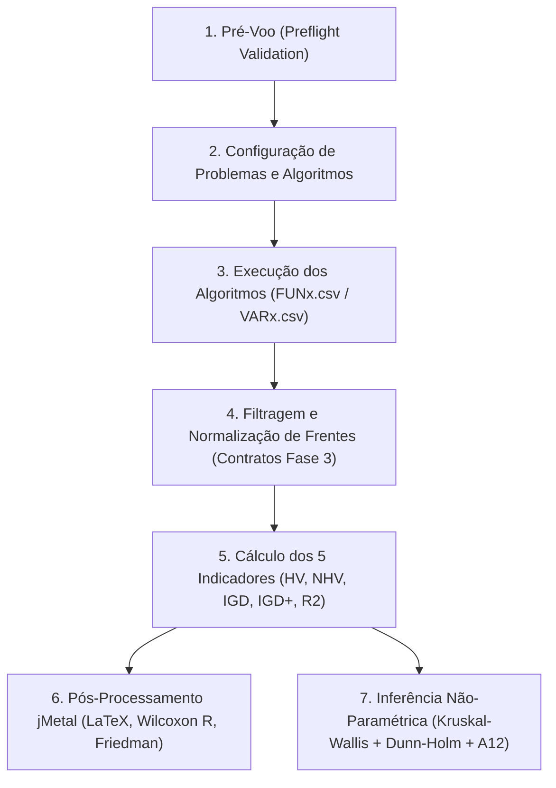

# Pipeline de Execução e Pós-Processamento Experimental (`hypeMOEA`)

Este documento descreve a arquitetura real do pipeline experimental em [WFGStudy.java](file:///c:/Users/vyctor922/Downloads/Mestrado/tema/experimento/java/hypeMOEA/src/main/java/br/usp/lti/newmoea/study/WFGStudy.java) sobre **Java 21** e **jMetal 7.8**, cobrindo desde a resolução pré-voo de artefatos canônicos até o cálculo de indicadores de qualidade e o fluxo de pós-processamento estatístico (jMetal LaTeX/R + inferência não-paramétrica para amostras independentes via `Kruskal-Wallis`, `Dunn-Holm` e $\hat{A}_{12}$ de Vargha-Delaney).

> [!IMPORTANT]
> Para verificar a lista de pendências de integração entre as classes utilitárias das Fases 3/4 e o método `WFGStudy.main()`, bem como o guia passo a passo de execução e o relatório completo de auditoria *Zero-Trust*, consulte [relatorio_auditoria-pre_execucao_final.md](file:///c:/Users/vyctor922/Downloads/Mestrado/tema/experimento/java/hypeMOEA/docs/relatorio_auditoria-pre_execucao_final.md).

---

## 1. Visão Geral da Arquitetura do Experimento (`WFGStudy`)

O estudo experimental compara **6 algoritmos evolutivos multiobjetivo e *many-objective* (MOEAs/MaOEAs)** nas suítes **WFG1–WFG9** e **DTLZ1–DTLZ7** para $m \in \{2, 3, 5, 8, 10, 15\}$ objetivos, com `INDEPENDENT_RUNS = 30` execuções independentes por par `(algoritmo, problema_m)`:

1. **`NSGAIII`** (`org.uma.jmetal.algorithm.multiobjective.nsgaiii.NSGAIII`)
2. **`MOEADD`** ([MOEADD.java](file:///c:/Users/vyctor922/Downloads/Mestrado/tema/experimento/java/hypeMOEA/src/main/java/br/usp/lti/newmoea/algorithm/moeadd/MOEADD.java))
3. **`FDEA`** ([FDEA.java](file:///c:/Users/vyctor922/Downloads/Mestrado/tema/experimento/java/hypeMOEA/src/main/java/br/usp/lti/newmoea/algorithm/fdea/FDEA.java))
4. **`RVEA`** ([RVEA.java](file:///c:/Users/vyctor922/Downloads/Mestrado/tema/experimento/java/hypeMOEA/src/main/java/br/usp/lti/newmoea/algorithm/rvea/RVEA.java))
5. **`AGE-MOEA`** (`org.uma.jmetal.algorithm.multiobjective.agemoea.AGEMOEA`)
6. **`AGE-MOEA-II`** (`org.uma.jmetal.algorithm.multiobjective.agemoeaii.AGEMOEAII`)

> **Nota sobre `HypE`:** Embora o pacote `br.usp.lti.newmoea.algorithm.hype` exista no repositório (contendo implementações localizadas e utilitários), o algoritmo `HypE` encontra-se comentado em `WFGStudy.configureAlgorithmList()` na campanha de linha de base atual.

### Fluxo de Etapas do Pipeline



---

## 2. Etapa 1: Validação Pré-Voo e Resolução Canônica de Artefatos

Antes de instanciar os algoritmos, [WFGStudy.java](file:///c:/Users/vyctor922/Downloads/Mestrado/tema/experimento/java/hypeMOEA/src/main/java/br/usp/lti/newmoea/study/WFGStudy.java) executa a validação pré-voo através de [ParetoFrontValidator.java](file:///c:/Users/vyctor922/Downloads/Mestrado/tema/experimento/java/hypeMOEA/src/main/java/br/usp/lti/newmoea/util/ParetoFrontValidator.java) e [ReferenceSetValidator.java](file:///c:/Users/vyctor922/Downloads/Mestrado/tema/experimento/java/hypeMOEA/src/main/java/br/usp/lti/newmoea/util/ReferenceSetValidator.java):

1. **Frentes de Referência (`ParetoFrontValidator.resolveReferenceFrontArtifact`):**
   - **Prioridade 1 (`CANONICAL_JMETAL`):** `resources/referenceFronts/<PROBLEM>.<m>D.csv` (utilizado para `WFG1`–`WFG9` e `DTLZ1`–`DTLZ7` em $m \in \{2, 3\}$).
   - **Prioridade 2 (`GENERATED_PF_GEN`):** `pf_gen/<PROBLEM>.<m>D.csv` (utilizado para $m \in \{5, 8, 10, 15\}$).
   - **Política de Zeros (`-DreplaceZeroFronts=false` por padrão):** As frentes canônicas preservam zeros exatos (`0.0`). Caso `-DreplaceZeroFronts=true` seja ativado, cópias sanitizadas (`0 -> 1e-5`) são gravadas em `target/sanitized_reference_fronts/`.
2. **Vetores de Pesos do `MOEA/DD` (`ReferenceSetValidator.resolveWeightArtifact`):**
   - **Diretório Canônico Ativo:** `resources/weightVectorFiles/W<m>D_<N>.dat` (disponível para $m \in \{2, 3, 5, 8, 10\}$).
   - **Política de Zeros (`-DreplaceZeroWeights=false` por padrão):** Os arquivos canônicos preservam coordenadas `0.0` nas bordas do simplex. Caso `-DreplaceZeroWeights=true`, cópias sanitizadas (`0 -> 1e-5`) são geradas em `target/sanitized_moead_weights/`.
   - **Caso $m=15$ (`W15D_135.dat`):** O arquivo físico `W15D_135.dat` reside em `MOEAD_Weights/W15D_135.dat` (ou pode ser gerado em memória por `MOEADD.initializeUniformWeight()`).

---

## 3. Etapa 2: Execução dos Algoritmos e Geração de Frentes Brutas

Na implementação atual de [WFGStudy.java](file:///c:/Users/vyctor922/Downloads/Mestrado/tema/experimento/java/hypeMOEA/src/main/java/br/usp/lti/newmoea/study/WFGStudy.java#L225):
- O componente `new ExecuteAlgorithms<>(experiment).run()` executa os jobs em paralelo (`NUMBER_OF_CORES = 8`).
- Para cada algoritmo, problema (`<PROBLEM>_<m>`) e `runId` ($0 \dots 29$), são gravados:
  - `WFGStudy/data/<ALGORITHM>/<PROBLEM>_<m>/FUN<runId>.csv`: valores dos objetivos da população final.
  - `WFGStudy/data/<ALGORITHM>/<PROBLEM>_<m>/VAR<runId>.csv`: variáveis de decisão da população final.

### Utilitários da Fase 3 Disponíveis para Execução Rigorosa
Para garantir equidade estrita de orçamento, reprodutibilidade determinística por semente e higienização das frentes de saída:
- **Orçamento Estrito de Avaliações ([EvaluationBudgetProblem.java](file:///c:/Users/vyctor922/Downloads/Mestrado/tema/experimento/java/hypeMOEA/src/main/java/br/usp/lti/newmoea/util/EvaluationBudgetProblem.java)):** Wrapper sobre `DoubleProblem` que contabiliza avaliações de forma thread-safe (`AtomicInteger`) e impede que `NSGA-III` e `AGE-MOEA`/`AGE-MOEA-II` ultrapassem $B = N_{\text{config}} \times G_{\max}$.
- **Executor Isolado com Sementes Determinísticas ([IsolatedJobExecutor.java](file:///c:/Users/vyctor922/Downloads/Mestrado/tema/experimento/java/hypeMOEA/src/main/java/br/usp/lti/newmoea/util/IsolatedJobExecutor.java)):** Executa cada job configurando `JMetalRandom.getInstance().setSeed(baseSeed + runId * 10007L + problemId * 101L)` e instanciando algoritmos sob demanda (*lazy instantiation*).
- **Filtragem de Dominadas e Duplicatas ([ResultFrontContract.java](file:///c:/Users/vyctor922/Downloads/Mestrado/tema/experimento/java/hypeMOEA/src/main/java/br/usp/lti/newmoea/util/ResultFrontContract.java)):** O método `ResultFrontContract.filterAndSanitize(front, 1e-12)` remove pontos com `NaN`/`Infinity`, soluções Pareto-dominadas (frequentes na população bruta de `MOEA/DD` e `RVEA`) e duplicatas com distância $L_\infty \le 10^{-12}$.

---

## 4. Etapa 3: Cálculo dos Indicadores de Qualidade (`ComputeQualityIndicators`)

O pipeline avalia **5 indicadores de qualidade** sobre as frentes `FUNx.csv` em relação à frente de referência de cada problema/dimensão:

| Sigla | Classe no Projeto / jMetal | Tipo | Orientação |
| :--- | :--- | :--- | :--- |
| **`HV`** | `org.uma.jmetal.qualityindicator.impl.hypervolume.impl.PISAHypervolume` (ou [ProcessIsolatedHypervolumeExecutor](file:///c:/Users/vyctor922/Downloads/Mestrado/tema/experimento/java/hypeMOEA/src/main/java/br/usp/lti/newmoea/util/ProcessIsolatedHypervolumeExecutor.java) / [MonteCarloHypervolume](file:///c:/Users/vyctor922/Downloads/Mestrado/tema/experimento/java/hypeMOEA/src/main/java/br/usp/lti/newmoea/util/MonteCarloHypervolume.java) em $m \ge 10$) | Convergência + Diversidade | **Maximização** ($\uparrow$) |
| **`NHV`** | `org.uma.jmetal.qualityindicator.impl.NormalizedHypervolume` ($1 - \text{HV}(A)/\text{HV}(PF_{\text{ref}})$) | Convergência + Diversidade | **Minimização** ($\downarrow$) |
| **`IGD`** | `org.uma.jmetal.qualityindicator.impl.InvertedGenerationalDistance` | Convergência + Cobertura | **Minimização** ($\downarrow$) |
| **`IGD+`** | `org.uma.jmetal.qualityindicator.impl.InvertedGenerationalDistancePlus` (fracamente Pareto-compatível) | Convergência + Cobertura | **Minimização** ($\downarrow$) |
| **`R2`** | [R2.java](file:///c:/Users/vyctor922/Downloads/Mestrado/tema/experimento/java/hypeMOEA/src/main/java/br/usp/lti/newmoea/qualityindicator/R2.java) (utilidade Tchebycheff ponderada) | Convergência + Diversidade | **Minimização** ($\downarrow$) |

### Artefatos Gerados por `ComputeQualityIndicators`
1. **Arquivos individuais por indicador:** `WFGStudy/data/<ALGORITHM>/<PROBLEM>_<m>/<INDICATOR>` (contendo 1 valor por linha correspondente a cada `FUN<runId>.csv`).
2. **Melhores e Medianas Frentes:** `BEST_<INDICATOR>_FUN.csv`, `BEST_<INDICATOR>_VAR.csv`, `MEDIAN_<INDICATOR>_FUN.csv` e `MEDIAN_<INDICATOR>_VAR.csv`.
3. **Arquivo Consolidado Mestre (`WFGStudy/QualityIndicatorSummary.csv`):**
   Formato CSV com cabeçalho:
   ```csv
   Algorithm,Problem,IndicatorName,ExecutionId,IndicatorValue
   NSGAIII,WFG1_2,HV,0,0.21634666518702558
   ...
   ```

### Normalização Analítica e Mitigação de Hipervolume em Alta Dimensão ($m \ge 10$)
- **Contrato de Normalização Analítica ([ObjectiveNormalizationContract.java](file:///c:/Users/vyctor922/Downloads/Mestrado/tema/experimento/java/hypeMOEA/src/main/java/br/usp/lti/newmoea/util/ObjectiveNormalizationContract.java)):**
  Em vez de depender dos extremos empíricos min-max do arquivo CSV de referência (que em $m=15$ subestimam os limites reais nas bordas), `ObjectiveNormalizationContract.fromStaticParams(problemName, m)` normaliza cada objetivo $f_i$ pelos limites analíticos verdadeiros $[z_i^*, z_i^{\text{nad}}]$ definidos em [StaticParams.java](file:///c:/Users/vyctor922/Downloads/Mestrado/tema/experimento/java/hypeMOEA/src/main/java/br/usp/lti/newmoea/study/StaticParams.java#L162-L214) ($[0, 2i]$ para WFG; $[0, 0.5]$ para DTLZ1; $[0, 1]$ para DTLZ2–4) e aplica ponto de referência explícito $r = (1.1, \dots, 1.1)^T$ para o Hipervolume.
- **Execução Isolada de Hipervolume e Monte Carlo ([ProcessIsolatedHypervolumeExecutor.java](file:///c:/Users/vyctor922/Downloads/Mestrado/tema/experimento/java/hypeMOEA/src/main/java/br/usp/lti/newmoea/util/ProcessIsolatedHypervolumeExecutor.java) & [MonteCarloHypervolume.java](file:///c:/Users/vyctor922/Downloads/Mestrado/tema/experimento/java/hypeMOEA/src/main/java/br/usp/lti/newmoea/util/MonteCarloHypervolume.java)):**
  Para $m \in \{10, 15\}$, o cálculo exato WFG/PISA HV tem complexidade exponencial ($\mathcal{O}(N^{m/2})$). O executor isolado dispara uma JVM filha com timeout rígido e, caso o cálculo exato exceda o tempo limite ou a memória (`TIMED_OUT_FALLBACK_MC` / `OOM_FALLBACK_MC`), retorna automaticamente a estimativa por amostragem de Monte Carlo determinística ($N_{\text{samples}} = 100.000$, erro padrão $\text{SE} \le 0,0016$).

---

## 5. Etapa 4: Pós-Processamento Estatístico e Geração de Tabelas

O pós-processamento divide-se em **dois fluxos complementares**: (A) os componentes nativos do jMetal 7.8 e (B) o protocolo estatístico não-paramétrico para amostras independentes implementado no projeto (`Kruskal-Wallis` + `Dunn-Holm` + $\hat{A}_{12}$ de Vargha-Delaney).

### 5.1. Fluxo A: Componentes Nativos do jMetal 7.8 (`WFGStudy.main()`)

Executados automaticamente ao final de `WFGStudy.main()` (desde que `study.outputDirectory` seja um nome simples sem subcaminhos aninhados):

1. **`GenerateLatexTablesWithStatistics`:**
   - **Saída:** `WFGStudy/latex/<experimentName>.tex`
   - **Conteúdo:** Tabelas LaTeX para cada indicador contendo **Média e Desvio Padrão** e **Mediana e Intervalo Interquartil (IQR)**, destacando em cinza escuro (`cellcolor{gray95}`) o melhor algoritmo e em cinza claro (`cellcolor{gray25}`) o segundo melhor por problema.
   - **Como compilar o PDF:**
     ```powershell
     Push-Location "WFGStudy/latex"
     pdflatex WFGStudy.tex
     Pop-Location
     ```

2. **`GenerateWilcoxonTestTablesWithR`:**
   - **Saída:** Scripts `.R` em `WFGStudy/R/*.Wilcoxon.R`
   - **Conteúdo:** Testes de soma de postos de Wilcoxon par-a-par com $\alpha = 0,05$, tendo o último algoritmo da lista (`AGE-MOEA-II`) como algoritmo de referência na tabela tabular de símbolos ($\blacktriangle$, $\triangledown$, $-$).
   - **Como gerar as tabelas `.tex` a partir dos scripts R:**
     ```powershell
     Push-Location "WFGStudy/R"
     Get-ChildItem -Filter "*.Wilcoxon.R" | ForEach-Object { Rscript $_.Name }
     Pop-Location
     ```

3. **`GenerateFriedmanTestTables`:**
   - **Saída:** `WFGStudy/latex/FriedmanTest<INDICATOR>.tex`
   - **Observação Metodológica (Gate G1 — `T21`):** O teste de Friedman trata cada problema ou *runId* como bloco pareado. Como as 30 execuções de algoritmos populacionais distintos usam sementes independentes sem pareamento natural entre o *run* $k$ do Algoritmo A e o *run* $k$ do Algoritmo B dentro de um mesmo problema, **a inferência primária por instância `(problema, m, indicador)` deve utilizar o protocolo de amostras independentes (Kruskal-Wallis + Dunn-Holm + Vargha-Delaney $\hat{A}_{12}$)** descrito a seguir.

---

### 5.2. Fluxo B: Inferência Não-Paramétrica para Amostras Independentes (`Kruskal-Wallis`, `Dunn-Holm` e $\hat{A}_{12}$)

Implementado em Java nas classes [KruskalWallisTest.java](file:///c:/Users/vyctor922/Downloads/Mestrado/tema/experimento/java/hypeMOEA/src/main/java/br/usp/lti/newmoea/statistics/KruskalWallisTest.java) e [DunnPostHocTest.java](file:///c:/Users/vyctor922/Downloads/Mestrado/tema/experimento/java/hypeMOEA/src/main/java/br/usp/lti/newmoea/statistics/DunnPostHocTest.java), e validado contra o R em [scripts/kruskal_dunn_holm.R](file:///c:/Users/vyctor922/Downloads/Mestrado/tema/experimento/java/hypeMOEA/scripts/kruskal_dunn_holm.R):

1. **Teste Omnibus de Kruskal-Wallis ($k = 6$ grupos independentes, $n_i = 30$ runs):**
   - Calcula os postos médios $\bar{R}_i$ no conjunto combinado $N = \sum n_i = 180$ com atribuição de postos médios (*mid-ranks*) para empates.
   - Aplica correção exata para empates:
     $$H_{\text{adj}} = \frac{\frac{12}{N(N+1)} \sum_{i=1}^{k} n_i \bar{R}_i^2 - 3(N+1)}{1 - \frac{\sum (t_j^3 - t_j)}{N^3 - N}}$$
   - Calcula o $p$-valor assintótico pela distribuição $\chi^2_{k-1}$ ($\text{gl} = 5$).

2. **Teste Post-Hoc de Dunn com Correção Step-Down de Holm (FWER $\alpha = 0,05$):**
   - Acionado quando o teste omnibus rejeita $H_0$ ($p < 0,05$).
   - Compara todos os $\binom{6}{2} = 15$ pares de algoritmos usando a variância conjunta dos postos com correção de empates:
     $$z_{A,B} = \frac{\bar{R}_A - \bar{R}_B}{\sqrt{\left(\frac{N(N+1)}{12} - \frac{\sum (t_j^3 - t_j)}{12(N-1)}\right)\left(\frac{1}{n_A} + \frac{1}{n_B}\right)}}$$
   - Ajusta os 15 $p$-valores bilaterais pelo procedimento *step-down* de Holm ($\tilde{p}_{(m)} = \min(1, \max_{j \le m} (M - j + 1) p_{(j)})$).

3. **Tamanho de Efeito Não-Paramétrico $\hat{A}_{12}$ de Vargha-Delaney:**
   - Mede a probabilidade estocástica de uma execução de $A$ superar uma execução de $B$:
     $$\hat{A}_{12}(A, B) = \frac{\#(a_i > b_j) + 0.5 \cdot \#(a_i = b_j)}{n_A n_B} \in [0, 1]$$
   - Classificação automática de magnitude (`Negligible`, `Small`, `Medium`, `Large`) conforme os limiares canônicos de Vargha & Delaney (2000): $|\hat{A}_{12} - 0,5|$ comparado a $\{0,06;\; 0,14;\; 0,21\}$.

#### Como Executar o Pós-Processamento `Kruskal-Wallis` + `Dunn-Holm` + $\hat{A}_{12}$

- **Via Testes Unitários / API Java (`KruskalWallisTest` & `DunnPostHocTest`):**
  ```powershell
  mvn test "-Dtest=KruskalWallisTestTest"
  ```
  Programaticamente, passe um `Map<String, double[]>` com as 30 execuções de cada algoritmo (lidas de `WFGStudy/data/<ALG>/<PROB>_<m>/<IND>` ou `QualityIndicatorSummary.csv`):
  ```java
  KruskalWallisTest.Result kw = KruskalWallisTest.evaluate(groups);
  if (kw.getPValue() < 0.05) {
      List<DunnPostHocTest.PairwiseComparison> postHoc = DunnPostHocTest.evaluateWithHolm(groups, 0.05);
  }
  ```

- **Via R (`scripts/kruskal_dunn_holm.R`):**
  Para validar o benchmark estatístico ou processar grupos no R:
  ```powershell
  Rscript scripts/kruskal_dunn_holm.R
  ```

---

## 6. Resumo de Comandos de Pós-Processamento Completo

Após a conclusão de todos os lotes da campanha em `WFGStudy/` (e geração de `WFGStudy/QualityIndicatorSummary.csv`):

```powershell
# 1. Compilar scripts R de Wilcoxon gerados pelo jMetal
Push-Location "WFGStudy/R"
Get-ChildItem -Filter "*.Wilcoxon.R" | ForEach-Object { Rscript $_.Name }
Pop-Location

# 2. Compilar tabelas LaTeX de Média/DP, Mediana/IQR e Friedman
Push-Location "WFGStudy/latex"
pdflatex WFGStudy.tex
Get-ChildItem -Filter "FriedmanTest*.tex" | ForEach-Object { pdflatex $_.Name }
Pop-Location

# 3. Executar script de inferência não-paramétrica Kruskal-Wallis + Dunn-Holm + A12
Rscript scripts/kruskal_dunn_holm.R
```
