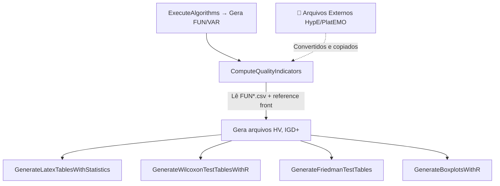

# Integração de Arquivos de saída no Pipeline de Pós-Processamento do jMetal

## Resposta Curta

**Sim, é perfeitamente possível.** O pipeline de pós-processamento do jMetal (`ComputeQualityIndicators`, `GenerateLatexTablesWithStatistics`, `GenerateWilcoxonTestTablesWithR`, `GenerateFriedmanTestTables`, `GenerateBoxplotsWithR`) trabalha exclusivamente sobre **arquivos em disco**, não sobre objetos em memória. Basta gerar os arquivos no formato e estrutura de diretórios corretos.

---

## Estrutura de Diretórios Esperada pelo jMetal

O pipeline espera esta hierarquia exata:

```
WFGStudy/
└── data/
    └── <NOME_ALGORITMO>/        ← ex: "HypE", "NSGAII", etc.
        └── <NOME_PROBLEMA>/     ← ex: "WFG1_2", "WFG4_5", "DTLZ2_3"
            ├── FUN0.csv         ← Frente de Pareto (objetivos) da execução 0
            ├── FUN1.csv         ← Frente de Pareto (objetivos) da execução 1
            ├── ...
            ├── FUN4.csv         ← (para 5 independent runs)
            ├── VAR0.csv         ← Variáveis de decisão da execução 0
            ├── VAR1.csv         ← Variáveis de decisão da execução 1
            ├── ...
            └── VAR4.csv
```

## Formato dos Arquivos

### FUNx.csv (Obrigatório)
Valores dos **objetivos** — cada linha é uma solução, colunas separadas por vírgula:
```csv
2.0365397930145264,0.03728274628520012
0.10703852772712708,3.256627321243286
0.5449009537696838,2.2978477478027344
```
- Sem cabeçalho
- Número de colunas = número de objetivos (2 para `_2`, 3 para `_3`, 5 para `_5`)

### VARx.csv (Obrigatório)
Valores das **variáveis de decisão** — mesma estrutura:
```csv
1.9738655062,3.9555652755,...
```
- Sem cabeçalho
- Número de colunas = número de variáveis

> [!IMPORTANT]
> Os arquivos `FUNx.csv` são os **essenciais** para o cálculo de indicadores de qualidade. Os `VARx.csv` são usados apenas para os arquivos BEST/MEDIAN. Se não tiver as variáveis, pode criar arquivos VAR dummy com zeros.

## Como o Pipeline Funciona (Passo a Passo)



O `ExecuteAlgorithms` apenas **gera os arquivos FUN/VAR**. Todos os passos seguintes (`ComputeQualityIndicators` em diante) apenas **leem esses arquivos do disco**. Logo, se você colocar os arquivos manualmente, o pipeline funciona normalmente.

---

## O que Precisa Ser Feito

### Opção A: Rodar HypE externamente (PlatEMO) e importar os resultados

O HypE existe no seu [PlatEMO](file:///c:/Users/vyctor922/Downloads/Mestrado/tema/experimento/PlatEMO/PlatEMO/Algorithms/Multi-objective%20optimization/HypE/HypE.m) mas **não existe no jMetal Java 6.9.3** (só existe no jMetalPy).

1. **Rodar o HypE no PlatEMO** para cada problema e cada run
2. **Exportar** os resultados (objetivos) para arquivos CSV
3. **Converter** o formato do PlatEMO para o formato jMetal (separador por vírgula, sem cabeçalho)
4. **Copiar** para a estrutura de diretórios correta

### Opção B: Implementar HypE diretamente no jMetal Java

Portar o algoritmo de MATLAB para Java implementando a interface `Algorithm<List<DoubleSolution>>` do jMetal, e adicioná-lo ao `configureAlgorithmList`.

### Opção C (Recomendada): Incluir HypE como "algoritmo fantasma" no pipeline

Modificar o [WFGStudy.java](file:///c:/Users/vyctor922/Downloads/Mestrado/tema/experimento/java/NewMOEA/src/main/java/br/usp/lti/newmoea/study/WFGStudy.java) para:
1. **Registrar** o HypE na lista de algoritmos (mesmo que não execute)
2. **Pular** o `ExecuteAlgorithms` (ou comentar essa linha)
3. Rodar apenas os passos de pós-processamento

---

## Modificações Necessárias no WFGStudy.java

Para usar a **Opção C**, as mudanças seriam mínimas:

```diff
 // No main():
-new ExecuteAlgorithms<>(experiment).run();
+// new ExecuteAlgorithms<>(experiment).run();  // Pular se os dados já existem
 new ComputeQualityIndicators<>(experiment).run();
 new GenerateLatexTablesWithStatistics(experiment).run();
 // ...
```

E na lista de algoritmos, adicionar um entry para o HypE (pode ser um builder qualquer, pois nunca será executado — só serve para o jMetal saber que existe um algoritmo chamado "HypE"):

```java
// Adicionar no configureAlgorithmList, junto com os outros:
algorithms.add(new ExperimentAlgorithm<>(
    buildNSGAII(problem, populationSize, crossover, mutation),  // placeholder
    "HypE",  // Este é o nome que será usado no diretório
    problemList.get(i), run));
```

> [!WARNING]
> O nome do algoritmo no `ExperimentAlgorithm` **deve corresponder exatamente** ao nome da pasta em `WFGStudy/data/`. Se a pasta se chama `HypE`, o algoritmo deve ser registrado como `"HypE"`.

---

## Checklist de Compatibilidade

| Requisito | Status |
|-----------|--------|
| Formato CSV sem cabeçalho | ✅ Fácil de converter |
| Separador por vírgula | ✅ Padrão |
| Mesmo número de runs (5) | ✅ Configurável no PlatEMO |
| Mesmos problemas (WFG1-9, DTLZ1-7) | ✅ Disponíveis no PlatEMO |
| Mesmos números de objetivos (2, 3, 5) | ✅ Configurável |
| Reference fronts existem | ✅ Já disponíveis em `pareto_fronts/csv/` |
| Naming convention `PROBLEMA_M` | ⚠️ Precisa criar pastas com nomes corretos |

## Conclusão

A integração é **totalmente viável** e relativamente simples. O pipeline do jMetal é baseado em arquivos, não em execução direta. Qualquer algoritmo cujos resultados possam ser exportados como CSV de objetivos pode ser integrado — seja HypE do PlatEMO, seja qualquer outro framework (MOEA Framework, Pymoo, etc.).
